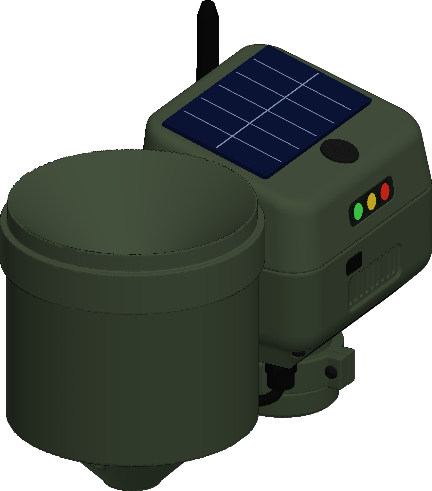
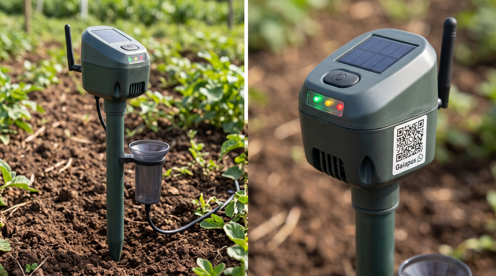
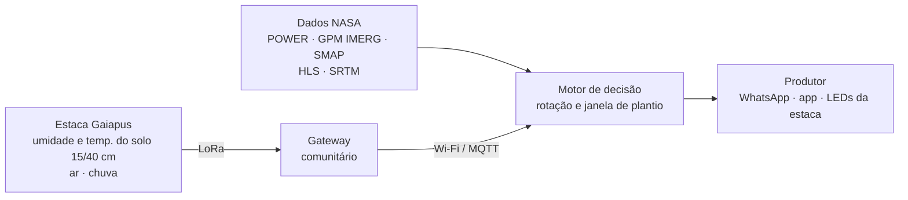

# Gaiapus · Field Shift

**NASA Space Apps Challenge 2026** · Desafio *Field Shift: Adapting Farms with NASA Data* · Equipe Gaiapus

O Gaiapus ajuda o agricultor a decidir **o que plantar em seguida e quando**, sem deixar o solo descoberto entre uma safra e outra. A recomendação parte de dados abertos da NASA, que cobrem qualquer lugar do planeta. Onde é preciso precisão local, uma **estaca de solo solar de baixo custo** mede o talhão e corrige o dado de satélite para aquele ponto.

> A ferramenta sugere e explica; a decisão final é sempre do agricultor e do agrônomo local.

| Modelo 3D da estaca (projeto real, gerado das placas e do case) | Conceito visual do produto (imagem ilustrativa gerada por IA) |
|---|---|
|  |  |

---

## O problema

- Os dados de satélite são a única fonte disponível para a maioria dos produtores, mas são **grossos para decidir num talhão**: a umidade do solo do SMAP vem em células de 9 km, a chuva do GPM IMERG em ~10 km, e nenhum satélite mede a temperatura do solo a 15 ou 40 cm.
- Sensores de solo comerciais custam **centenas de dólares por profundidade**, mais datalogger. Ficam fora do alcance de quem mais precisa de orientação.
- No mundo, mais de 500 milhões de propriedades familiares produzem cerca de 80 % dos alimentos em valor (FAO), e a agricultura usa cerca de 72 % da água doce retirada (FAO, AQUASTAT 2025).
- **(Brasil, região do piloto)** 77 % dos estabelecimentos rurais são de agricultura familiar e só cerca de 20 % recebem assistência técnica (IBGE, Censo Agro 2017).

## A solução em três degraus

| Degrau | Para quem | O que vai ao campo | Como o produtor recebe |
|---|---|---|---|
| **0 · Satélite** | qualquer produtor, custo zero | nada, só a localização | app e WhatsApp (áudio e texto) |
| **1 · Estaca** | pequena propriedade | 1 estaca solar + 1 gateway comunitário (cooperativa, assistência técnica) | WhatsApp + LEDs verde/amarelo/vermelho na estaca |
| **2 · Rede** | médias e grandes | várias estacas por zona de manejo | app por talhão |

---

## O que está neste repositório

Este repositório contém o **dispositivo**: hardware, firmware, mecânica e simulação. O app e o motor de decisão com os dados da NASA ficam no repositório da equipe de software. Os dois se ligam pelo contrato de dados em [`docs/protocolo-dados.md`](docs/protocolo-dados.md).

### Estado atual
| Parte | Situação | Evidência |
|---|---|---|
| Esquemático das 2 placas (cabeça + sonda) | completo, ERC sem erros | `hardware/gaiapus-node`, `hardware/gaiapus-probe` |
| PCB da cabeça (90 × 50 mm, 4 camadas) | roteada 51/51 redes, DRC sem erros | `hardware/gaiapus-node/*.kicad_pcb`, modelo 3D `.glb`/`.step` |
| PCB da sonda (22 × 450 mm, 2 camadas) | roteada 12/12 redes, DRC sem erros | `hardware/gaiapus-probe/*.kicad_pcb` |
| Lista de materiais com custo | todas as peças principais com código LCSC e preço | `bom/bom_custos_BRL.xlsx` |
| Orçamento de energia | calculado com valores de datasheet | `power/power_budget.py` |
| Case e estaca | desenhos, STL para impressão, montagem 3D completa, 23/23 folgas conferidas | `mechanical/` |
| Firmware da estaca e do gateway | completo, testado no PC (9 h simuladas, queda de rede, reenvio) | `firmware/` |
| Simulação | firmware de bancada pronto para o Wokwi | `sim/wokwi/` |
| Protótipo físico da PCB | **ainda não fabricado** | — |

### Números principais
| | Valor |
|---|---|
| Medições | umidade e temperatura do solo a 15 e 40 cm, temperatura e umidade do ar, chuva, bateria |
| Rádio | LoRa (SX1262), faixa regional 868/915 MHz configurável; 25 bytes a cada 30 min |
| Consumo | 1,2–1,8 mAh/dia (média 50–75 µA) |
| Energia | painel de 0,3 W (68 × 37 mm) + célula LiFePO4 18650; saldo positivo mesmo em dia nublado |
| Autonomia sem sol | cerca de 1 ano pelo cálculo (meta era 14 dias) |
| Custo de componentes | ≈ US$ 30 por estaca (1 unidade), menos em lote; PCB, montagem e case a cotar |
| Comparação | um sensor comercial de 1 profundidade custa US$ 258–615, sem contar o logger |

Detalhes, fontes e limites de cada número: [`docs/hardware.md`](docs/hardware.md).

---

## Por onde começar

### Avaliadores
1. [`docs/hardware.md`](docs/hardware.md): por que cada componente, consumo, custo, comparação com o mercado, riscos.
2. [`docs/firmware.md`](docs/firmware.md): como a estaca mede, guarda e envia os dados até o app.
3. [`docs/protocolo-dados.md`](docs/protocolo-dados.md): o pacote de 25 bytes e o JSON que o app recebe.
4. Modelo 3D da estaca inteira: [`mechanical/cad/gaiapus-stake-revB-assembly.glb`](mechanical/cad/gaiapus-stake-revB-assembly.glb) (abre no Visualizador 3D do Windows, no Blender ou em https://gltf-viewer.donmccurdy.com).
5. Desenhos do case: [`mechanical/drawings/gaiapus-case-revB.pdf`](mechanical/drawings/gaiapus-case-revB.pdf).
6. Decisões de projeto e seus motivos: [`docs/decisoes.md`](docs/decisoes.md).

### Equipe
| Quero... | Faça |
|---|---|
| Abrir as placas | KiCad 8: `hardware/gaiapus-node/gaiapus-node.kicad_pro` e `hardware/gaiapus-probe/gaiapus-probe.kicad_pro` |
| Mudar o circuito | editar `hardware/tools/gen_kicad.py` e rodar `check_kicad.py` (ver [`hardware/README.md`](hardware/README.md)); feche o KiCad antes |
| Gravar a estaca | `cd firmware && pio run -e stake-lora -t upload` (outros alvos em [`firmware/README.md`](firmware/README.md)) |
| Rodar os testes do firmware | em `firmware/test`, comandos em [`firmware/README.md`](firmware/README.md) (só precisa de `gcc` e `python3`) |
| Simular no Wokwi | [`sim/wokwi/README.md`](sim/wokwi/README.md) |
| Recalcular a energia | `python power/power_budget.py --help` |
| Integrar o app | assinar `gaiapus/devices/+/up` e publicar o comando em `gaiapus/devices/{id}/down` ([`docs/protocolo-dados.md`](docs/protocolo-dados.md)) |

---

## Estrutura

| Pasta | Conteúdo |
|---|---|
| `docs/` | documentação: hardware, firmware, protocolo, requisitos, decisões |
| `hardware/gaiapus-node/` | placa-cabeça (KiCad 8): ESP32-S3, rádio LoRa, energia solar, sensor de ar, LEDs, USB-C |
| `hardware/gaiapus-probe/` | placa-sonda (KiCad 8): eletrodos de umidade e sensores de temperatura dentro do tubo |
| `hardware/lib/` | símbolos, footprints e modelos 3D |
| `hardware/datasheets/` | datasheet de cada componente principal |
| `hardware/tools/` | scripts de geração, posicionamento, roteamento e verificação das placas |
| `bom/` | lista de materiais e custos |
| `power/` | orçamento de energia |
| `firmware/` | firmware da estaca, do gateway e da bancada, com testes |
| `sim/wokwi/` | simulação do firmware de bancada |
| `mechanical/` | case, estaca, desenhos, STL e montagem 3D |
| `renders/` | imagens de conceito |

---

## Limites declarados

- A PCB **ainda não foi fabricada**. Consumo, alcance do rádio e leitura dos sensores vêm de datasheets, cálculo e simulação, não de medição.
- A medida de umidade **através da parede do tubo** é uma premissa a testar em solo real. Se a parede atenuar demais, o plano B é abrir janelas no tubo sem mudar a placa.
- A estaca mede para **decidir** (irrigar, plantar, esperar), não para pesquisa: precisa de calibração por sonda (ar e água) e por tipo de solo.
- O preço citado é de **componentes**, não de venda.
- Os dados marcados **(Brasil)** são do piloto em Uberlândia (MG). O hardware e o método valem para qualquer região.

## Regras de projeto do hardware (para o time)

1. Tudo SMD soldado direto na placa, com módulos certificados para rádio e MCU. Sem barra de pinos, soquetes ou placas de desenvolvimento.
2. Todo componente com footprint, modelo 3D, datasheet e código LCSC (custo e montagem na JLCPCB).
3. Toda escolha relevante vai para [`docs/decisoes.md`](docs/decisoes.md) com o motivo.
4. Dado de um país específico é sempre marcado como tal.
