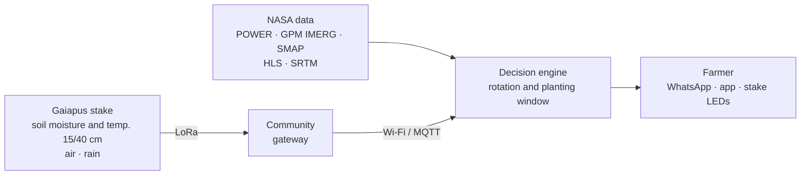

# Gaiapus · Field Shift

**NASA Space Apps Challenge 2026** · Challenge *Field Shift: Adapting Farms with NASA Data* · Team Gaiapus

Gaiapus helps farmers decide **what to plant next, and when**, without leaving the soil bare between one crop and the next. Recommendations start from open NASA data, which covers any place on the planet. Where local precision matters, a **low-cost solar soil stake** measures the field and corrects the satellite data for that spot.

> The tool suggests and explains; the final decision always belongs to the farmer and the local agronomist.

| 3D model of the stake (real design, generated from the boards and the case) | Product concept (illustrative image, **AI-generated**) |
|---|---|
|  |  |

*Portuguese version: [`README.pt-BR.md`](README.pt-BR.md).*

---

## The problem

- Satellite data is the only source available to most farmers, but it is **too coarse to decide on a single field**: SMAP soil moisture comes in 9 km cells, GPM IMERG rainfall in ~10 km cells, and no satellite measures soil temperature at 15 or 40 cm.
- Commercial soil sensors cost **hundreds of dollars per depth**, plus a datalogger. They are out of reach for the farmers who most need guidance.
- Worldwide, more than 500 million family farms produce about 80 % of the world's food by value (FAO), and agriculture accounts for about 72 % of all freshwater withdrawals (FAO, AQUASTAT 2025).
- **(Brazil, pilot region)** 77 % of rural establishments are family farms and only about 20 % receive technical assistance (IBGE, Agricultural Census 2017).

## The solution in three tiers

| Tier | For whom | What goes to the field | How the farmer receives it |
|---|---|---|---|
| **0 · Satellite** | any farmer, zero cost | nothing, just the location | app and WhatsApp (voice and text) |
| **1 · Stake** | small farms | 1 solar stake + 1 community gateway (cooperative, extension service) | WhatsApp + green/yellow/red LEDs on the stake |
| **2 · Network** | medium and large farms | several stakes per management zone | app, per field |

---

## What is in this repository

This repository contains the **device**: hardware, firmware and mechanics. The app and the decision engine with the NASA data live in the software team's repository. The two connect through the data contract in [`docs/protocolo-dados.md`](docs/protocolo-dados.md) (Portuguese).

### Current status
| Part | Status | Evidence |
|---|---|---|
| Schematics of both boards (head + probe) | complete, ERC with no errors | `hardware/gaiapus-node`, `hardware/gaiapus-probe` |
| Head PCB (90 × 50 mm, 4 layers) | routed 51/51 nets, DRC with no errors | `hardware/gaiapus-node/*.kicad_pcb`, 3D model `.glb`/`.step` |
| Probe PCB (22 × 450 mm, 2 layers) | routed 12/12 nets, DRC with no errors | `hardware/gaiapus-probe/*.kicad_pcb` |
| Bill of materials with cost | every main part with LCSC code and price | `bom/bom_custos_BRL.xlsx` |
| Power budget | computed from datasheet values | `power/power_budget.py` |
| Case, stake and rain gauge (rev G) | drawings, printable 3MF files, full 3D assembly, 36/36 checks passed, 0 mm³ interference | `mechanical/` |
| Stake and gateway firmware | complete, tested on a PC (9 simulated hours, network outage, resend) | `firmware/` |
| Bench prototype | dev-board ESP32 + off-the-shelf sensors, same firmware and protocol | `firmware/src/main.cpp` |
| Physical PCB prototype | **not manufactured yet** | — |

### Key numbers
| | Value |
|---|---|
| Measurements | soil moisture and temperature at 15 and 40 cm, air temperature and humidity, rainfall, battery |
| Radio | LoRa (SX1262), configurable regional band 868/915 MHz; 25 bytes every 30 min |
| Consumption | 1.2–1.8 mAh/day (50–75 µA average) |
| Energy | 0.3 W panel (68 × 37 mm) + LiFePO4 18650 cell; positive balance even on a cloudy day |
| Autonomy without sun | about 1 year by calculation (target was 14 days) |
| Rain gauge | tipping bucket, 100 mm collector, 0.201 mm per pulse |
| Component cost | ≈ US$ 30 per stake (1 unit), less in volume; PCB, assembly and case still to be quoted |
| Comparison | a commercial single-depth sensor costs US$ 258–615, without the logger |

Details, sources and limits of each number: [`docs/hardware.md`](docs/hardware.md).

---

## Where to start

### Judges and reviewers
1. [`docs/hardware.md`](docs/hardware.md): why each component, power, cost, market comparison, risks.
2. [`docs/firmware.md`](docs/firmware.md): how the stake measures, stores and sends data all the way to the app.
3. [`docs/protocolo-dados.md`](docs/protocolo-dados.md) (Portuguese): the 25-byte packet and the JSON the app receives.
4. 3D model of the whole stake: [`mechanical/cad/revG/gaiapus-stake-revG-assembly.glb`](mechanical/cad/revG/gaiapus-stake-revG-assembly.glb) (opens in Windows 3D Viewer, Blender or https://gltf-viewer.donmccurdy.com).
5. Case and rain-gauge drawings: [`mechanical/drawings/gaiapus-case-revG.pdf`](mechanical/drawings/gaiapus-case-revG.pdf); exploded view: [`mechanical/cad/revG/renders/exploded-revG.png`](mechanical/cad/revG/renders/exploded-revG.png).
6. Design decisions and their reasons: [`docs/decisoes.md`](docs/decisoes.md) (Portuguese).

### Team
| I want to... | Do |
|---|---|
| Open the boards | KiCad 8: `hardware/gaiapus-node/gaiapus-node.kicad_pro` and `hardware/gaiapus-probe/gaiapus-probe.kicad_pro` |
| Change the circuit | edit `hardware/tools/gen_kicad.py` and run `check_kicad.py` (see [`hardware/README.md`](hardware/README.md)); close KiCad first |
| Flash the stake | `cd firmware && pio run -e stake-lora -t upload` (other targets in [`firmware/README.md`](firmware/README.md)) |
| Run the firmware tests | in `firmware/test`, commands in [`firmware/README.md`](firmware/README.md) (needs only `gcc` and `python3`) |
| Recompute the energy budget | `python power/power_budget.py --help` |
| Integrate the app | subscribe to `gaiapus/devices/+/up` and publish the command to `gaiapus/devices/{id}/down` ([`docs/protocolo-dados.md`](docs/protocolo-dados.md)) |

---

## Structure

| Folder | Contents |
|---|---|
| `docs/` | documentation: hardware, firmware, protocol, requirements, decisions |
| `hardware/gaiapus-node/` | head board (KiCad 8): ESP32-S3, LoRa radio, solar power, air sensor, LEDs, USB-C |
| `hardware/gaiapus-probe/` | probe board (KiCad 8): moisture electrodes and temperature sensors inside the tube |
| `hardware/lib/` | symbols, footprints and 3D models |
| `hardware/datasheets/` | datasheet of every main component |
| `hardware/tools/` | board generation, placement, routing and verification scripts |
| `bom/` | bill of materials and costs |
| `power/` | power budget |
| `firmware/` | stake, gateway and bench firmware, with tests |
| `mechanical/` | case, stake, rain gauge, drawings, printable parts and 3D assembly |
| `renders/` | concept images (AI-generated) |

---

## Declared limits

- The PCB **has not been manufactured yet**. Power, radio range and sensor readings come from datasheets, calculation and simulation, not from measurement.
- Measuring moisture **through the tube wall** is an assumption to be tested in real soil. If the wall attenuates too much, plan B is to open windows in the tube without changing the board.
- The stake measures to **decide** (irrigate, plant, wait), not for research: it needs per-probe calibration (air and water) and per-soil-type calibration.
- The price quoted is for **components**, not a retail price.
- Data marked **(Brazil)** comes from the pilot in Uberlândia (MG). The hardware and the method apply to any region.

## NASA data and other sources

- **NASA:** POWER (temperature, solar radiation; also used to size the solar panel), GPM IMERG (rainfall), SMAP L4 (soil moisture), HLS (vegetation, bare soil), SRTM (elevation, slope).
- **Other:** ZARC agricultural climate-risk zoning (MAPA, Brazil), SoilGrids (ISRIC), IBGE Agricultural Census 2017, FAO, ANA.
- **Tools and libraries:** KiCad 8, PlatformIO/Arduino, RadioLib, PubSubClient, DHTesp, LCSC/JLCPCB part library and 3D models, component datasheets in `hardware/datasheets/`.

## AI assistance

In line with the NASA Space Apps rules on Super Intelligence (SI) tools:

- **Images:** `renders/design-base-v1.jpg` is an **AI-generated** concept image, used only as a style reference. All other renders and drawings are generated from our own CAD and KiCad models.
- **Code:** parts of the firmware and of the Python tooling (board generation, routing and verification, mechanical CAD and drawings, power budget) were written with the help of an AI assistant (Claude, by Anthropic) and reviewed, tested and integrated by the team.
- **Text:** documentation drafts and translations were produced with AI assistance and reviewed by the team.

No NASA logos or branding are used in this project.

## Hardware design rules (for the team)

1. Everything SMD soldered directly to the board, with certified modules for radio and MCU. No pin headers, sockets or development boards.
2. Every component with footprint, 3D model, datasheet and LCSC code (cost and assembly at JLCPCB).
3. Every relevant choice goes into [`docs/decisoes.md`](docs/decisoes.md) with its reason.
4. Data from a specific country is always marked as such.
