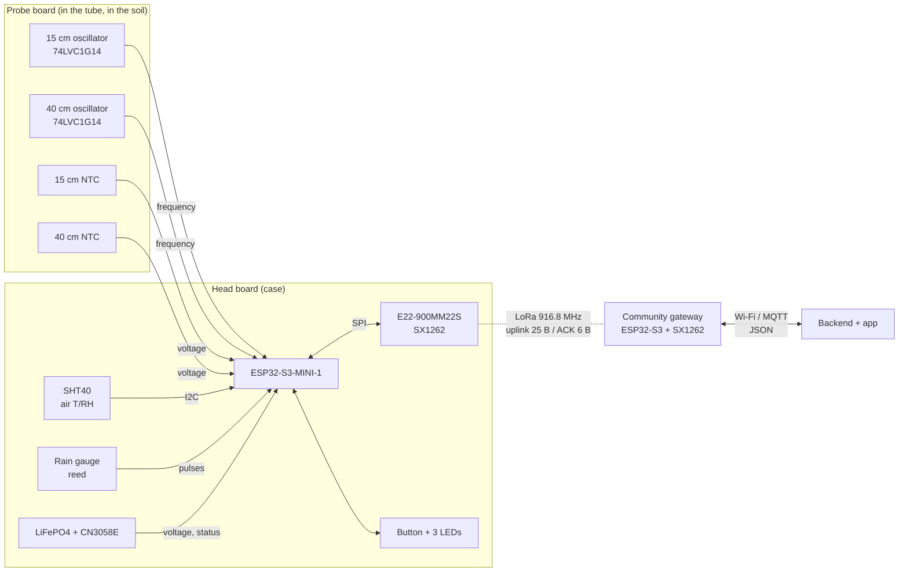
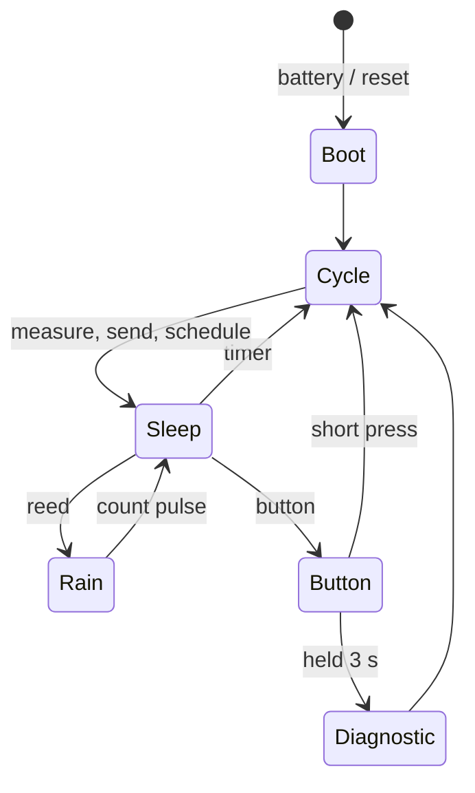
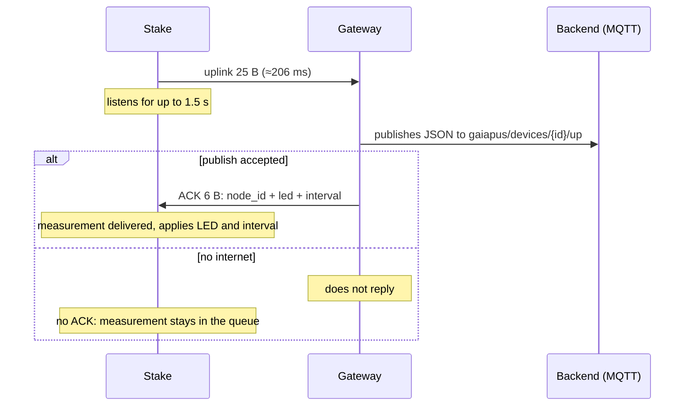

# Gaiapus firmware · stake and gateway

Firmware reference document. It explains how the stake boots and identifies itself, how it reads each sensor, how it builds the packet and delivers it to the gateway, and what the data looks like at each stage on the way to the backend.

Formal data contract: [`protocolo-dados.md`](protocolo-dados.md) (Portuguese). Decisions and reasons: [`decisoes.md`](decisoes.md) (Portuguese; D15, D24, D25, D26). Code and tests: [`firmware/`](../firmware/README.md). Portuguese version of this document: [`firmware.pt-BR.md`](firmware.pt-BR.md).

---

## 1. Overview



There are three firmwares that use **the same 25-byte packet**:

| Firmware | Runs on | Purpose | Code |
|---|---|---|---|
| Stake | Gaiapus PCB (head + probe) | product: measures, stores and sends | `firmware/src/stake/` |
| Gateway | head board on USB-C, or Heltec WiFi LoRa 32 V3 | receives over LoRa, publishes to MQTT, acknowledges | `firmware/src/gateway/` |
| Bench | ESP32-S3 dev board + off-the-shelf sensors | demonstration and simulation | `firmware/src/main.cpp` |

The stake also has a **Wi-Fi** mode (`stake-wifi`): the board itself publishes to MQTT, with no gateway. It is used for the demonstration.

---

## 2. Boot and identification

### 2.1 Stake identity
- The `device_id` is fixed at the factory: the **last 4 bytes of the MAC** of the ESP32-S3, written as 8 lowercase hex digits.
  E.g. MAC `24:0a:c4:00:01:10` → `node_id = 0xC4000110` → `device_id = "c4000110"`.
- There is nothing to configure on the stake: the ID is in the chip, not in memory.
- It goes in every packet (bytes 1–4), in the MQTT topic (`gaiapus/devices/c4000110/up`), in the JSON and in the backend `event_id`.
- The gateway uses the same scheme for its `gateway_id`.

### 2.2 First boot (battery inserted, reset or USB flashing)
1. Pins return to a safe state: probe off, LEDs off, radio with NSS/NRST high.
2. USB serial starts without blocking (if no computer is connected, nothing hangs).
3. The state kept in **RTC RAM** is checked against a magic number. On first boot it is invalid and is cleared:
   `seq = 0`, `interval_min = 30`, `led = off`, empty queue.
4. The log shows the identity: `[boot] gaiapus stake c4000110  link=lora  wake=0`.
5. The LEDs do a **green → yellow → red sweep**: a sign of life for the installer.
6. The stake **measures and sends right away** (it does not wait 30 min), receives the first command from the gateway and goes to sleep.

### 2.3 Field registration (where the stake is)
The stake has no GPS. Its position is recorded by the installer's phone:

1. Scan the QR code on the case (app URL with the `device_id` and an ownership code).
2. The app saves the phone's GPS position and the farmer chooses the farm and field.
3. Press the stake button: it sends right away and the app confirms "connected via gateway X".

Each measurement belongs to the installation active at that moment. The `gateway_id` in each message indicates the approximate area and makes it possible to raise an alert if the stake is heard by an unexpected gateway. Details in `protocolo-dados.md` → *Cadastro da estaca*.

### 2.4 State that survives sleep (RTC RAM)
| Field | Use |
|---|---|
| `seq` | number of the last measurement |
| `interval_min`, `led` | last command received |
| `rain_pulses` | rain pulses since the last measurement |
| `pending_flags` | button pressed, goes in the next measurement |
| `next_due_s` | when the next measurement is due |
| 48-measurement queue | packets not yet acknowledged, with the time they were measured |
| counters | delivered, dropped, failures, boots |
| Wi-Fi cache | channel and BSSID of the last AP, time of the last NTP sync |

If the battery is removed, this state is lost: the stake goes back to step 2.2 and `seq` restarts at 1. The backend tells them apart by date (`observed_at`).

---

## 3. Life cycle: deep sleep and wake-ups

The ESP32 spends almost all its time in **deep sleep**. Each wake-up runs the program from the start and ends by going back to sleep.

| What woke it | What the stake does |
|---|---|
| **Timer** (every `interval_min`, ±3 % random) | measure → queue → send → sleep |
| **Rain gauge** (reed, GPIO17) | counts 1 pulse and goes back to sleep until the scheduled measurement |
| **Button** (GPIO0), short press | lights the current-state LED for 8 s, measures and sends right away ("button" flag) |
| **Button** held for 3 s | **diagnostic mode** over USB (section 9) |
| Battery inserted / reset | section 2.2 |



The ±3 % on the interval makes stakes installed together drift apart in time, so they do not always transmit at the same instant.

**Pins held during sleep** (to save battery): radio NSS and NRST high (the SX1262 stays asleep), TXEN/RXEN low (RF switch off), probe power and LEDs low.

**Stuck reed:** if the rain-gauge bucket stops with the magnet over the reed, the pin stays low and would wake the stake continuously. The firmware detects this and stops waking on rain until the next timer cycle.

---

## 4. How data comes from the sensors

Reading order in each cycle: air → moisture 15 cm → moisture 40 cm → soil temperature → battery → charger. Total awake time spent measuring: about 60 ms.

### 4.1 Soil moisture (15 and 40 cm)
- On the probe, each interdigitated electrode forms, with the 47 kΩ resistor, an **RC oscillator** with the 74LVC1G14. Wetter soil = more capacitance = **lower frequency** (0.5 to 2 MHz).
- The oscillator is only powered during the reading (`PWR_OSC15` / `PWR_OSC40`), and **one at a time**, so the two electrodes do not influence each other.
- Sequence: power the oscillator → wait 3 ms → the ESP32-S3 **PCNT** (pulse counter) counts edges for 10 ms → power off.
- The count is corrected by the actual measured time, so it is exactly 10 ms. The PCNT is 16-bit; the firmware handles overflow (works with both IDF 4.4 and 5.x drivers).
- **Value sent:** `raw = frequency / 100` (e.g. 1.83 MHz → 18,342). Expected range 5,000 – 20,000.
- `raw = 0`: no oscillation (probe disconnected or broken cable) → sensor error flag.
- Moisture is sent **raw**. Conversion to m³/m³ is done in the backend with the factory calibration (air and water) and the soil-type calibration.

### 4.2 Soil temperature (15 and 40 cm)
- 10 kΩ NTC (B = 3380) to ground, with a 10 kΩ resistor from `PWR_NTC`, which is only on during the reading.
- Waits 2 ms, averages 8 ADC readings in millivolts (`analogReadMilliVolts`, factory-calibrated).
- `R_ntc = 10 kΩ × V / (3300 − V)` and `T = 1 / (ln(R/10k)/3380 + 1/298.15) − 273.15`.
- Voltage below 30 mV or above 3270 mV = NTC shorted or open → invalid value (`−32768` in the packet, `null` in the JSON) and error flag.

### 4.3 Air: temperature and relative humidity (SHT40)
- I2C at address `0x44`, high-repeatability measurement (command `0xFD`, 10 ms).
- Each value comes with a **CRC-8**, which is checked. On failure, it retries once.
- `T = −45 + 175 × raw/65535` and `RH = −6 + 125 × raw/65535` (clamped to 0–100 %).
- No response: invalid temperature, RH = 0 and error flag.

### 4.4 Rainfall
- Tipping-bucket rain gauge with a reed to ground (470 kΩ pull-up and 10 nF capacitor on the board).
- Pulses **during sleep**: each one wakes the stake, which counts it and goes back to sleep.
- Pulses **while awake**: counted by interrupt, with a 50 ms debounce filter.
- The packet carries the **pulses since the previous measurement**. Conversion to millimetres (`rain_mm = pulses × mm_per_pulse`) is done in the gateway/backend. The `mm_per_pulse` value comes from the mechanics: **0.201 mm** for the rev G gauge (calculated; to be confirmed with a calibration pour).

### 4.5 Battery and solar charging
- Voltage: 2.2 MΩ + 2.2 MΩ divider with 100 nF → `VBAT = 2 × ADC reading`, average of 8 samples.
- Below 3000 mV: "low battery" flag.
- CN3058E charger: `CHRG` pin low = charging → "charging" flag (shows in the app that the panel is working).

---

## 5. Data packet (uplink, 25 bytes)

All fields longer than 1 byte are **little-endian**.

| Byte | Field | Type | Unit / meaning |
|---|---|---|---|
| 0 | version | uint8 | = 1 |
| 1–4 | `node_id` | uint32 | stake identity |
| 5–6 | `seq` | uint16 | measurement number (unchanged on resend) |
| 7–8 | `raw_15` | uint16 | raw moisture 15 cm (f/100) |
| 9–10 | `raw_40` | uint16 | raw moisture 40 cm |
| 11–12 | `t_solo_15` (soil temp 15 cm) | int16 | 0.01 °C (−32768 = invalid) |
| 13–14 | `t_solo_40` (soil temp 40 cm) | int16 | 0.01 °C |
| 15–16 | `t_ar` (air temp) | int16 | 0.01 °C |
| 17 | `ur_ar` (air RH) | uint8 | % |
| 18–19 | `chuva_pulsos` (rain pulses) | uint16 | pulses in the interval |
| 20–21 | `vbat` | uint16 | mV |
| 22–23 | `idade_min` (age) | uint16 | minutes since the measurement (0 = now; > 0 = resend) |
| 24 | `flags` | uint8 | bit0 button · bit1 low battery · bit2 sensor error · bit3 charging |

**Example:** stake `c4000110`, measurement 128, moisture 18,342 / 21,011, soil 24.31 / 23.10 °C, air 29.80 °C and 54 %, 2 rain pulses, 3,285 mV:

```
01 10 01 00 C4 80 00 A6 47 13 52 7F 09 06 09 A4 0B 36 02 00 D5 0C 00 00 00
│  └─node_id──┘ └seq┘ └r15┘ └r40┘ └t15┘ └t40┘ └tair┘RH └rain┘└bat┘ └age┘ flags
version
```

The stake **has no real-time clock** and does not need one: it only sends the age of the measurement, and the receiver computes `observed_at = received_at − idade_min`.

Single C implementation: `firmware/include/gaiapus_protocol.h` (used by the stake, gateway, bench and tests). Python mirror for the backend: `firmware/tools/gaiapus_decode.py`.

---

## 6. Sending to the gateway (LoRa)

### 6.1 Radio parameters
| Parameter | Value |
|---|---|
| Frequency | 916.8 MHz (915–928 MHz band, Anatel / AU915); configurable for US915 or EU868 |
| Spreading factor / bandwidth | SF9 / 125 kHz |
| Coding | 4/5, CRC on, preamble 8 |
| Sync word | 0x12 (private network; LoRaWAN uses 0x34) |
| Power | 14 dBm (the module goes up to 22 dBm) |
| Time on air | uplink 25 B ≈ 206 ms · ACK 6 B ≈ 124 ms |
| Module | E22-900MM22S: RF switch driven by TXEN/RXEN from the ESP32. The firmware currently tries a TCXO on DIO3 (1.8 V) first and falls back to the crystal; the MM22S has a passive crystal, so this will be set to crystal directly (see `hardware.md` § 10) |

Stake and gateway compile with the **same** radio configuration file (`src/stake/config.h`), so they cannot diverge.

### 6.2 Message exchange



- **The ACK is the command itself.** The 6-byte frame (`node_id` + `led` + `interval_min`) confirms delivery and carries the LED state and the interval. Example for `c4000110`, yellow, 30 min: `10 01 00 C4 02 1E`.
- The `node_id` is in the frame because **every stake hears the gateway**: each one only accepts the frame with its own number.
- The gateway only replies **after** MQTT has accepted the publish. Without internet, the stake gets no ACK and loses nothing.

### 6.3 Queue and resend
- Every measurement goes into the queue first (48 slots = 24 h at 30 min). When the queue is full, the oldest is dropped.
- In each cycle the stake sends **the newest first** (the app gets current data before the backlog) and then up to 3 older ones, each with its own `idade_min`.
- Without an ACK, it stops and tries again in the next cycle. The backend discards duplicates by `event_id` (`device_id-seq-depth`).
- Battery below 2.9 V: it measures and stores, but does not transmit until the battery recovers.

### 6.4 Stake in Wi-Fi mode (demonstration)
Same cycle, but the stake itself connects to Wi-Fi (using the stored channel and BSSID for a fast connection), sets its clock by NTP on first use and once a day, publishes the same JSON (with `lora_payload_hex`, the 25 bytes that would have gone over the radio) and reads the **retained** command on its `down` topic. An accepted publish counts as delivery. Minimum battery for Wi-Fi: 3.1 V. The `stake-wifi-demo` target compresses 30 min into 1 min for the video.

---

## 7. Gateway

Always on (USB or power supply), listening to the radio continuously.

For each packet received:
1. 6-byte frame (reply from another gateway): ignore.
2. Wrong size or version, CRC error: ignore and count as noise.
3. Valid uplink: build the JSON (section 8.2) and publish to `gaiapus/devices/{device_id}/up`.
4. Published: wait 20 ms and reply with the stake's ACK (the command stored for it or, if none, LED off and 30 min).
5. Go back to listening.

**Backend commands:** the gateway subscribes to `gaiapus/devices/+/down`. Messages are **retained**, so on start-up it already receives the last command for each stake (up to 64 stored). A partial command (only `led`) keeps the interval; an empty retained message clears the command.

**Health:**
- Publishes `gaiapus/gateways/{gateway_id}/status` every 5 min (retained).
- Board LEDs: green = all OK (blinks on each packet), yellow = Wi-Fi OK but no MQTT/NTP, red = no Wi-Fi or radio not responding.
- Restarts after 30 min without Wi-Fi; re-initialises the radio after 15 min without any packet.

---

## 8. Data format at each stage

### 8.1 Radio
- Uplink: 25 bytes (section 5).
- Downlink/ACK: 6 bytes = `node_id` (4, little-endian) + `led` (0 off, 1 green, 2 yellow, 3 red) + `interval_min` (1–255; 0 becomes 30).

### 8.2 MQTT: measurement (`gaiapus/devices/{device_id}/up`)
Example of the packet from section 5, received at 13:30:02 UTC:
```json
{
  "device_id": "c4000110",
  "seq": 128,
  "observed_at": "2026-11-14T13:30:02Z",
  "received_at": "2026-11-14T13:30:02Z",
  "readings": [
    {"depth_cm": 15, "raw_moisture": 18342, "soil_temp_c": 24.31},
    {"depth_cm": 40, "raw_moisture": 21011, "soil_temp_c": 23.10}
  ],
  "air_temp_c": 29.80,
  "air_rh_pct": 54,
  "rain_mm": 0.40,
  "battery_mv": 3285,
  "rssi": -97,
  "snr": 7.5,
  "flags": 0,
  "gateway_id": "9f3e0a12"
}
```
- Invalid temperature → `null`. `rssi`/`snr` are from the LoRa link (on the Wi-Fi stake, `rssi` is the Wi-Fi RSSI and `snr` is `null`).
- `gateway_id` only exists when the data came through a gateway. `lora_payload_hex` only exists on the bench and the Wi-Fi stake.
- The JSON is produced by a single piece of C code (`firmware/include/gaiapus_json.h`), identical to the Python `to_mqtt_json()`.

### 8.3 MQTT: command (`gaiapus/devices/{device_id}/down`, retained)
```json
{"led": 2, "intervalo_min": 30}
```
(`intervalo_min` is the interval in minutes; the key name is kept as implemented.)

### 8.4 MQTT: gateway health (`gaiapus/gateways/{gateway_id}/status`, retained)
```json
{"gateway_id": "9f3e0a12", "fw": "gw-1.0", "uptime_s": 332, "rx_ok": 8, "rx_bad": 2,
 "rx_other": 1, "acked": 7, "no_backend": 1, "stakes_cached": 1, "radio_ok": true,
 "wifi_rssi": -61, "freq_mhz": 916.8, "sf": 9}
```

### 8.5 Backend: app events
One event per depth: `event_id = device_id-seq-depth_cm` (e.g. `c4000110-128-15`), with `observed_at`, `raw_moisture`, `moisture_m3_m3` (after calibration), `soil_temp_c`, `battery_mv` and `quality` (`ok` or `suspect`, from the error flag and the valid range). Full table in `protocolo-dados.md`.

---

## 9. Diagnostic mode and calibration

Hold the button for 3 s when waking the stake:
- The USB log shows the state (seq, interval, LED, queue, delivered, dropped, boots) and, every second, for up to 3 min:
  `raw15=18342 raw40=21011  t15=24.31 t40=23.10  air=29.80C 54%  vbat=3285mV  chg=1 done=0`
- The LEDs cycle green → yellow → red. Pressing again ends the mode, and the stake runs a normal cycle.

Use during assembly: record `raw15`/`raw40` with the probe **in air** and **in water**. These two points for each probe are the factory calibration the backend uses.

---

## 10. LEDs and button (what the farmer sees)

| Situation | LED |
|---|---|
| Battery inserted | green → yellow → red sweep |
| End of each cycle | 120 ms flash in the recommended colour (nothing if there is no recommendation) |
| Button press | recommended colour lit for 8 s; if there is no recommendation yet, a sweep |
| Diagnostic | colours cycling every second |

The colour (green, yellow, red) is decided by the backend and arrives in the ACK. Blinking every few seconds would mean waking the stake every few seconds and would almost double daily consumption, so the LED only lights on demand.

---

## 11. Build and configuration

PlatformIO, in `firmware/platformio.ini`:

| Target | Purpose |
|---|---|
| `stake-lora` | stake, product |
| `stake-wifi` | stake without a gateway (demonstration) |
| `stake-wifi-demo` | Wi-Fi stake with a 1-min cycle (video) |
| `gateway` | gateway on the Gaiapus head board |
| `gateway-heltec-v3` | gateway on a Heltec WiFi LoRa 32 V3 |
| `bench-esp32s3` | bench |

```
pio run -e stake-lora -t upload && pio device monitor
```
- Wi-Fi: add `-DWIFI_SSID=\"network\" -DWIFI_PASS=\"password\"` to `build_flags` (Wi-Fi stake and gateway).
- Flashing over USB-C. If the port does not appear, hold the button while plugging in USB (ESP32 download mode).
- All parameters (interval, battery limits, radio, timings) are in `firmware/src/stake/config.h` and `firmware/src/gateway/gw_config.h`, and can be overridden with `-D`.

---

## 12. Tests

They run on any PC with `gcc` and `python3` (commands in `firmware/README.md`):

| Test | What it proves |
|---|---|
| `test_protocol.c` | packet byte by byte, invalid values, downlink and addressed frame |
| `gaiapus_decode.py --selftest` | backend decoder |
| `host_stake.cpp` | 9 simulated hours of the stake: gateway outage and resend with age, rain, button, diagnostics, interval change, disconnected probe, frame for another stake, low battery, stuck reed. LoRa and Wi-Fi, IDF 4.4 and 5.x drivers |
| `host_gateway.cpp` | retained/live/partial/cleared commands, unknown stake, noise, internet loss and recovery |
| `cross_check.py` | every JSON published by stake, gateway and bench is identical, field by field, to the one produced by the Python decoder from the same bytes |

The PC tests validate the logic, the packet and the JSON. RF, oscillator, PCNT on the real pads and sleep current can only be validated on the board (bring-up checklist in `firmware/README.md`).

---

## 13. Known limitations and next steps

| Topic | Today (Rev A) | Next step |
|---|---|---|
| Radio security | LoRa P2P with no encryption or authentication | LoRaWAN AU915 (AES) |
| MQTT security | public broker, no password or TLS (demonstration) | own broker with username/password and TLS |
| Gateway configuration | Wi-Fi set at build time | configuration portal from a phone |
| Stake clock | internal oscillator, drifts a few minutes per day | irrelevant for the data (the gateway timestamps) |
| Updates | over USB-C (F10) | over-the-air updates |
| Location | recorded by the phone at installation | GPS/accelerometer if movement detection is needed |
| Pending values | `mm_per_pulse` 0.201 mm calculated, to be confirmed by a calibration pour; air/water calibration per probe | measure on the printed gauge and during assembly |

---

## 14. File map

```
firmware/
├── platformio.ini              build targets
├── include/
│   ├── gaiapus_protocol.h      25 B packet, downlink, 6 B frame
│   ├── gaiapus_json.h          bytes → MQTT JSON
│   └── pinos.h                 GPIO map (= schematic)
├── src/
│   ├── main.cpp                bench
│   ├── stake/
│   │   ├── config.h            stake and radio parameters
│   │   ├── stake_main.cpp      boot, wake-ups, cycle, LEDs, diagnostics, sleep
│   │   ├── stake_core.*        queue, schedule, RTC RAM state (hardware-independent)
│   │   ├── sensors.*           PCNT, NTC, battery, SHT40, charger
│   │   ├── radio.*             SX1262 via RadioLib
│   │   └── link_lora.cpp / link_wifi.cpp
│   └── gateway/
│       ├── gw_config.h
│       └── gateway_main.cpp
├── tools/gaiapus_decode.py     reference decoder (backend)
└── test/                       PC tests and mocks
```
