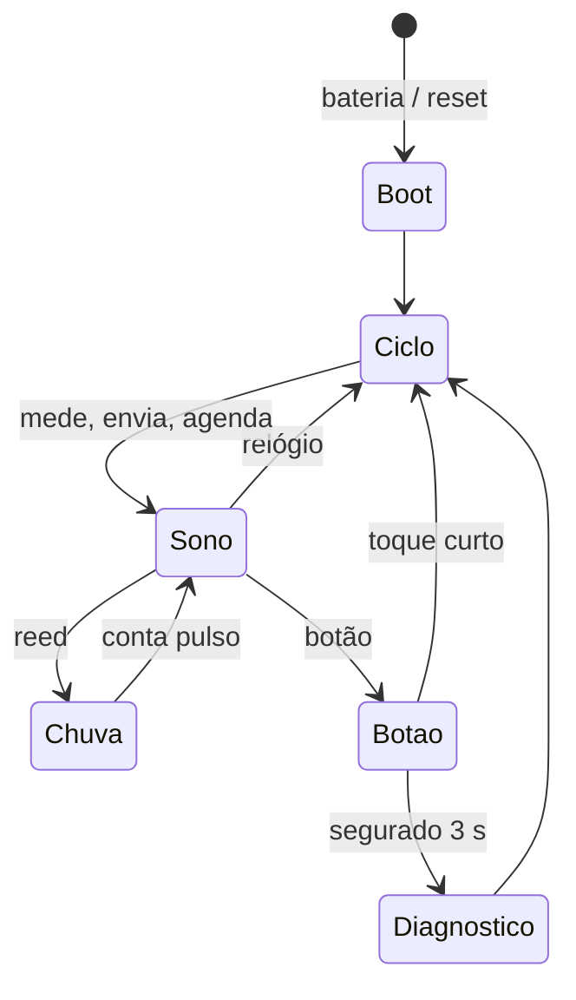
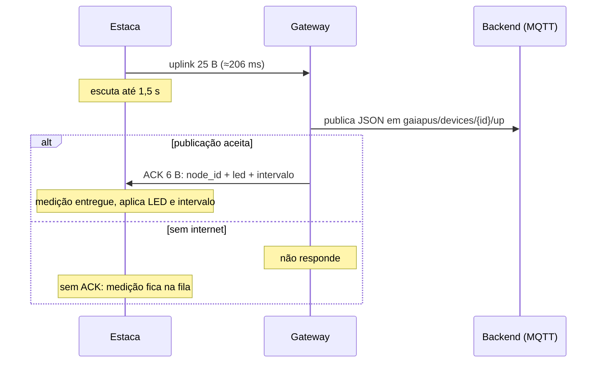

# Firmware Gaiapus · estaca e gateway

Documento de referência do firmware. Explica como a estaca liga e se identifica, como lê cada sensor, como monta o pacote e o entrega ao gateway, e qual é o formato dos dados em cada etapa até o backend.

Contrato formal dos dados: [`protocolo-dados.md`](protocolo-dados.md). Decisões e motivos: [`decisoes.md`](decisoes.md) (D15, D24, D25, D26). Código e testes: [`firmware/`](../firmware/README.md).

---

## 1. Visão geral


São três firmwares que usam **o mesmo pacote de 25 bytes**:

| Firmware | Onde roda | Para quê | Código |
|---|---|---|---|
| Estaca | PCB Gaiapus (cabeça + sonda) | produto: mede, guarda e envia | `firmware/src/stake/` |
| Gateway | placa-cabeça na USB-C, ou Heltec WiFi LoRa 32 V3 | recebe por LoRa, publica no MQTT, confirma | `firmware/src/gateway/` |
| Bancada / Wokwi | ESP32-S3 de desenvolvimento + sensores comprados | demonstração e simulação | `firmware/src/main.cpp` |

A estaca também tem um modo **Wi-Fi** (`stake-wifi`): a própria placa publica no MQTT, sem gateway. Serve para a demonstração.

---

## 2. Inicialização e identificação

### 2.1 Identidade da estaca
- O `device_id` é fixo e vem de fábrica: os **4 últimos bytes do MAC** do ESP32-S3, escritos como 8 hexadecimais minúsculos.
  Ex.: MAC `24:0a:c4:00:01:10` → `node_id = 0xC4000110` → `device_id = "c4000110"`.
- Não há nada para configurar na estaca: o ID está no chip, não na memória.
- Ele vai em todo pacote (bytes 1–4), no tópico MQTT (`gaiapus/devices/c4000110/up`), no JSON e no `event_id` do backend.
- O gateway usa o mesmo esquema para o seu `gateway_id`.

### 2.2 Primeiro boot (bateria colocada, reset ou gravação pela USB)
1. Os pinos voltam ao estado seguro: sonda desligada, LEDs apagados, rádio com NSS/NRST em nível alto.
2. A USB serial é iniciada sem bloquear (se não houver computador ligado, nada trava).
3. O estado guardado na **RAM RTC** é verificado por um número mágico. No primeiro boot ele é inválido e é zerado:
   `seq = 0`, `intervalo_min = 30`, `led = apagado`, fila vazia.
4. O log mostra a identidade: `[boot] gaiapus stake c4000110  link=lora  wake=0`.
5. Os LEDs fazem uma **varredura verde → amarelo → vermelho**: sinal de vida para quem está instalando.
6. A estaca **mede e envia na hora** (não espera 30 min), recebe o primeiro comando do gateway e dorme.

### 2.3 Cadastro no campo (onde a estaca está)
A estaca não tem GPS. A posição é registrada pelo celular de quem instala:

1. Escanear o QR do case (URL do app com o `device_id` e um código de posse).
2. O app grava a posição GPS do celular e o produtor escolhe fazenda e talhão.
3. Apertar o botão da estaca: ela envia na hora e o app confirma "conectada via gateway X".

Cada medição pertence à instalação ativa naquele momento. O `gateway_id` em cada mensagem indica a área aproximada e permite alertar se a estaca for ouvida por um gateway inesperado. Detalhes em `protocolo-dados.md` → *Cadastro da estaca*.

### 2.4 Estado que sobrevive ao sono (RAM RTC)
| Campo | Uso |
|---|---|
| `seq` | número da última medição |
| `interval_min`, `led` | último comando recebido |
| `rain_pulses` | pulsos de chuva desde a última medição |
| `pending_flags` | botão apertado, vai na próxima medição |
| `next_due_s` | quando é a próxima medição |
| fila de 48 medições | pacotes ainda não confirmados, com a hora em que foram medidos |
| contadores | entregues, descartadas, falhas, boots |
| cache Wi-Fi | canal e BSSID do último AP, hora do último NTP |

Se a bateria for retirada, esse estado se perde: a estaca volta ao passo 2.2 e o `seq` recomeça em 1. O backend distingue pelas datas (`observed_at`).

---

## 3. Ciclo de vida: sono profundo e despertares

O ESP32 passa quase todo o tempo em **sono profundo**. Cada despertar executa o programa do início e termina dormindo de novo.

| O que acordou | O que a estaca faz |
|---|---|
| **Relógio** (a cada `intervalo_min`, ±3 % aleatório) | mede → coloca na fila → envia → dorme |
| **Pluviômetro** (reed, GPIO17) | conta 1 pulso e volta a dormir até a medição marcada |
| **Botão** (GPIO0), toque curto | acende o LED do estado atual por 8 s, mede e envia na hora (flag "botão") |
| **Botão** segurado 3 s | **modo diagnóstico** pela USB (seção 9) |
| Bateria colocada / reset | seção 2.2 |



O ±3 % no intervalo faz estacas instaladas juntas se espalharem no tempo e não transmitirem sempre no mesmo instante.

**Pinos travados durante o sono** (para não gastar bateria): NSS e NRST do rádio em alto (o SX1262 continua dormindo), TXEN/RXEN em baixo (chave de RF desligada), alimentação da sonda e LEDs em baixo.

**Reed preso:** se o balde do pluviômetro parar com o ímã sobre o reed, o pino fica em nível baixo e acordaria a estaca sem parar. O firmware detecta isso e deixa de acordar pela chuva até o próximo ciclo do relógio.

---

## 4. Como os dados chegam dos sensores

Ordem de leitura em cada ciclo: ar → umidade 15 cm → umidade 40 cm → temperatura do solo → bateria → carregador. Tempo total acordado medindo: cerca de 60 ms.

### 4.1 Umidade do solo (15 e 40 cm)
- Na sonda, cada eletrodo interdigitado forma, com o resistor de 47 kΩ, um **oscilador RC** com o 74LVC1G14. Solo mais úmido = mais capacitância = **frequência menor** (0,5 a 2 MHz).
- O oscilador só é alimentado durante a leitura (`PWR_OSC15` / `PWR_OSC40`), e **um de cada vez**, para os dois eletrodos não se influenciarem.
- Sequência: liga o oscilador → espera 3 ms → o **PCNT** (contador de pulsos do ESP32-S3) conta as bordas por 10 ms → desliga.
- A contagem é corrigida pelo tempo real medido, para ficar exatamente em 10 ms. O PCNT tem 16 bits; o firmware trata o estouro (funciona nos drivers do IDF 4.4 e 5.x).
- **Valor enviado:** `raw = frequência / 100` (ex.: 1,83 MHz → 18 342). Faixa esperada 5 000 – 20 000.
- `raw = 0`: nenhuma oscilação (sonda desconectada ou cabo rompido) → flag de erro de sensor.
- A umidade sai **bruta**. A conversão para m³/m³ é feita no backend com a calibração de fábrica (ar e água) e a do tipo de solo.

### 4.2 Temperatura do solo (15 e 40 cm)
- NTC 10 kΩ (B = 3380) ao terra, com resistor de 10 kΩ vindo de `PWR_NTC`, que só é ligado durante a leitura.
- Espera 2 ms, faz a média de 8 leituras do ADC em milivolts (`analogReadMilliVolts`, calibrado de fábrica).
- `R_ntc = 10 kΩ × V / (3300 − V)` e `T = 1 / (ln(R/10k)/3380 + 1/298,15) − 273,15`.
- Tensão abaixo de 30 mV ou acima de 3270 mV = NTC em curto ou aberto → valor inválido (`−32768` no pacote, `null` no JSON) e flag de erro.

### 4.3 Ar: temperatura e umidade relativa (SHT40)
- I2C no endereço `0x44`, medição de alta repetibilidade (comando `0xFD`, 10 ms).
- Cada valor vem com **CRC-8**, que é conferido. Se falhar, tenta mais uma vez.
- `T = −45 + 175 × raw/65535` e `UR = −6 + 125 × raw/65535` (limitada a 0–100 %).
- Sem resposta: temperatura inválida, UR = 0 e flag de erro.

### 4.4 Chuva
- Pluviômetro de báscula com reed ao terra (pull-up de 470 kΩ e capacitor de 10 nF na placa).
- Pulsos **durante o sono**: cada um acorda a estaca, que conta e volta a dormir.
- Pulsos **com a estaca acordada**: contados por interrupção, com 50 ms de filtro contra repique.
- O pacote leva os **pulsos desde a medição anterior**. A conversão para milímetros (`rain_mm = pulsos × mm_por_pulso`) é feita no gateway/backend. O valor de `mm_por_pulso` vem da mecânica (provisório: 0,2 mm).

### 4.5 Bateria e carga solar
- Tensão: divisor 2,2 MΩ + 2,2 MΩ com 100 nF → `VBAT = 2 × leitura do ADC`, média de 8 amostras.
- Abaixo de 3000 mV: flag "bateria baixa".
- Carregador CN3058E: pino `CHRG` em nível baixo = carregando → flag "carregando" (mostra no app que o painel está funcionando).

---

## 5. Pacote de dados (uplink, 25 bytes)

Todos os campos com mais de 1 byte são **little-endian**.

| Byte | Campo | Tipo | Unidade / significado |
|---|---|---|---|
| 0 | versão | uint8 | = 1 |
| 1–4 | `node_id` | uint32 | identidade da estaca |
| 5–6 | `seq` | uint16 | número da medição (não muda no reenvio) |
| 7–8 | `raw_15` | uint16 | umidade bruta 15 cm (f/100) |
| 9–10 | `raw_40` | uint16 | umidade bruta 40 cm |
| 11–12 | `t_solo_15` | int16 | 0,01 °C (−32768 = inválido) |
| 13–14 | `t_solo_40` | int16 | 0,01 °C |
| 15–16 | `t_ar` | int16 | 0,01 °C |
| 17 | `ur_ar` | uint8 | % |
| 18–19 | `chuva_pulsos` | uint16 | pulsos no intervalo |
| 20–21 | `vbat` | uint16 | mV |
| 22–23 | `idade_min` | uint16 | minutos desde a medição (0 = agora; > 0 = reenvio) |
| 24 | `flags` | uint8 | bit0 botão · bit1 bateria baixa · bit2 erro de sensor · bit3 carregando |

**Exemplo:** estaca `c4000110`, medição 128, umidade 18 342 / 21 011, solo 24,31 / 23,10 °C, ar 29,80 °C e 54 %, 2 pulsos de chuva, 3 285 mV:

```
01 10 01 00 C4 80 00 A6 47 13 52 7F 09 06 09 A4 0B 36 02 00 D5 0C 00 00 00
│  └─node_id──┘ └seq┘ └r15┘ └r40┘ └t15┘ └t40┘ └tar┘ UR └chv┘ └bat┘ └idd┘ flags
versão
```

A estaca **não tem relógio de verdade** e não precisa: ela envia só a idade da medição, e quem recebe calcula `observed_at = received_at − idade_min`.

Implementação única em C: `firmware/include/gaiapus_protocol.h` (usada pela estaca, gateway, bancada e testes). Espelho em Python para o backend: `firmware/tools/gaiapus_decode.py`.

---

## 6. Envio ao gateway (LoRa)

### 6.1 Parâmetros do rádio
| Parâmetro | Valor |
|---|---|
| Frequência | 916,8 MHz (faixa 915–928 MHz, Anatel / AU915) |
| Spreading factor / banda | SF9 / 125 kHz |
| Codificação | 4/5, CRC ligado, preâmbulo 8 |
| Sync word | 0x12 (rede privada; LoRaWAN usa 0x34) |
| Potência | 14 dBm (o módulo vai até 22 dBm) |
| Tempo no ar | uplink 25 B ≈ 206 ms · ACK 6 B ≈ 124 ms |
| Módulo | E22-900MM22S: TCXO alimentado pelo DIO3 (1,8 V); chave de RF por TXEN/RXEN do ESP32 |

Estaca e gateway compilam com o **mesmo** arquivo de configuração de rádio (`src/stake/config.h`), então não há como divergirem.

### 6.2 Troca de mensagens



- **O ACK é o próprio comando.** O quadro de 6 bytes (`node_id` + `led` + `intervalo_min`) confirma a entrega e leva o estado do LED e o intervalo. Exemplo para `c4000110`, amarelo, 30 min: `10 01 00 C4 02 1E`.
- O `node_id` no quadro existe porque **todas as estacas ouvem o gateway**: cada uma só aceita o quadro com o seu número.
- O gateway só responde **depois** de o MQTT aceitar a publicação. Sem internet, a estaca não recebe ACK e não perde nada.

### 6.3 Fila e reenvio
- Toda medição entra primeiro na fila (48 posições = 24 h a cada 30 min). Fila cheia: a mais antiga é descartada.
- Em cada ciclo a estaca envia **a mais nova primeiro** (o app recebe o dado atual antes do atraso) e depois até 3 atrasadas, cada uma com a sua `idade_min`.
- Sem ACK, para e tenta de novo no próximo ciclo. O backend descarta duplicatas pelo `event_id` (`device_id-seq-profundidade`).
- Bateria abaixo de 2,9 V: mede e guarda, mas não transmite até a bateria se recuperar.

### 6.4 Estaca em modo Wi-Fi (demonstração)
Mesmo ciclo, mas a própria estaca conecta no Wi-Fi (usando canal e BSSID guardados para conectar rápido), acerta o relógio por NTP no primeiro uso e uma vez por dia, publica o mesmo JSON (com `lora_payload_hex`, os 25 bytes que iriam pelo rádio) e lê o comando **retido** no seu tópico `down`. A publicação aceita vale como entrega. Bateria mínima para Wi-Fi: 3,1 V. O alvo `stake-wifi-demo` comprime 30 min em 1 min para o vídeo.

---

## 7. Gateway

Fica sempre ligado (USB ou fonte), escutando o rádio continuamente.

Para cada pacote recebido:
1. Quadro de 6 bytes (resposta de outro gateway): ignora.
2. Tamanho ou versão errados, erro de CRC: ignora e conta como ruído.
3. Uplink válido: monta o JSON (seção 8.2) e publica em `gaiapus/devices/{device_id}/up`.
4. Publicou: espera 20 ms e responde com o ACK da estaca (comando guardado para ela ou, se não houver, LED apagado e 30 min).
5. Volta a escutar.

**Comandos do backend:** o gateway assina `gaiapus/devices/+/down`. As mensagens são **retidas**, então ao ligar ele já recebe o último comando de cada estaca (até 64 guardadas). Comando parcial (só `led`) mantém o intervalo; mensagem retida vazia apaga o comando.

**Saúde:**
- Publica `gaiapus/gateways/{gateway_id}/status` a cada 5 min (retido).
- LEDs da placa: verde = tudo ok (pisca a cada pacote), amarelo = Wi-Fi ok mas sem MQTT/NTP, vermelho = sem Wi-Fi ou rádio sem responder.
- Reinicia após 30 min sem Wi-Fi; reinicializa o rádio após 15 min sem nenhum pacote.

---

## 8. Formato dos dados em cada etapa

### 8.1 Rádio
- Uplink: 25 bytes (seção 5).
- Downlink/ACK: 6 bytes = `node_id` (4, little-endian) + `led` (0 apagado, 1 verde, 2 amarelo, 3 vermelho) + `intervalo_min` (1–255; 0 vira 30).

### 8.2 MQTT: medição (`gaiapus/devices/{device_id}/up`)
Exemplo do pacote da seção 5, recebido às 13:30:02 UTC:
```json
{
  "device_id": "c4000110",
  "seq": 128,
  "observed_at": "2026-11-14T13:30:02Z",
  "received_at": "2026-11-14T13:30:02Z",
  "readings": [
    {"depth_cm": 15, "raw_moisture": 18342, "soil_temp_c": 24.31},
    {"depth_cm": 40, "raw_moisture": 21011, "soil_temp_c": 23.10}
  ],
  "air_temp_c": 29.80,
  "air_rh_pct": 54,
  "rain_mm": 0.40,
  "battery_mv": 3285,
  "rssi": -97,
  "snr": 7.5,
  "flags": 0,
  "gateway_id": "9f3e0a12"
}
```
- Temperatura inválida → `null`. `rssi`/`snr` são do enlace LoRa (na estaca Wi-Fi, `rssi` é do Wi-Fi e `snr` é `null`).
- `gateway_id` só existe quando veio por gateway. `lora_payload_hex` só existe na bancada e na estaca Wi-Fi.
- O JSON é gerado por um único código em C (`firmware/include/gaiapus_json.h`), igual ao `to_mqtt_json()` do Python.

### 8.3 MQTT: comando (`gaiapus/devices/{device_id}/down`, retido)
```json
{"led": 2, "intervalo_min": 30}
```

### 8.4 MQTT: saúde do gateway (`gaiapus/gateways/{gateway_id}/status`, retido)
```json
{"gateway_id": "9f3e0a12", "fw": "gw-1.0", "uptime_s": 332, "rx_ok": 8, "rx_bad": 2,
 "rx_other": 1, "acked": 7, "no_backend": 1, "stakes_cached": 1, "radio_ok": true,
 "wifi_rssi": -61, "freq_mhz": 916.8, "sf": 9}
```

### 8.5 Backend: eventos do app
Um evento por profundidade: `event_id = device_id-seq-depth_cm` (ex.: `c4000110-128-15`), com `observed_at`, `raw_moisture`, `moisture_m3_m3` (após calibração), `soil_temp_c`, `battery_mv` e `quality` (`ok` ou `suspect`, a partir da flag de erro e da faixa válida). Tabela completa em `protocolo-dados.md`.

---

## 9. Modo diagnóstico e calibração

Segurar o botão por 3 s ao acordar a estaca:
- O log USB mostra o estado (seq, intervalo, LED, fila, entregues, descartadas, boots) e, a cada segundo, por até 3 min:
  `raw15=18342 raw40=21011  t15=24.31 t40=23.10  air=29.80C 54%  vbat=3285mV  chg=1 done=0`
- Os LEDs giram verde → amarelo → vermelho. Apertar de novo encerra, e a estaca faz um ciclo normal.

Uso na montagem: anotar `raw15`/`raw40` com a sonda **no ar** e **na água**. Esses dois pontos de cada sonda são a calibração de fábrica que o backend usa.

---

## 10. LEDs e botão (o que o produtor vê)

| Situação | LED |
|---|---|
| Bateria colocada | varredura verde → amarelo → vermelho |
| Fim de cada ciclo | flash de 120 ms na cor recomendada (nada se não houver recomendação) |
| Toque no botão | cor recomendada acesa por 8 s; sem recomendação ainda, varredura |
| Diagnóstico | cores girando a cada segundo |

A cor (verde, amarelo, vermelho) é decidida pelo backend e chega no ACK. Piscar a cada poucos segundos exigiria acordar a estaca a cada poucos segundos e quase dobraria o consumo diário, por isso o LED só acende sob demanda.

---

## 11. Compilação e configuração

PlatformIO, em `firmware/platformio.ini`:

| Alvo | Para quê |
|---|---|
| `stake-lora` | estaca, produto |
| `stake-wifi` | estaca sem gateway (demonstração) |
| `stake-wifi-demo` | estaca Wi-Fi com ciclo de 1 min (vídeo) |
| `gateway` | gateway na placa-cabeça Gaiapus |
| `gateway-heltec-v3` | gateway numa Heltec WiFi LoRa 32 V3 |
| `bench-esp32s3` | bancada / Wokwi |

```
pio run -e stake-lora -t upload && pio device monitor
```
- Wi-Fi: acrescentar `-DWIFI_SSID=\"rede\" -DWIFI_PASS=\"senha\"` em `build_flags` (estaca Wi-Fi e gateway).
- Gravação pela USB-C. Se a porta não aparecer, segurar o botão ao ligar a USB (modo download do ESP32).
- Todos os parâmetros (intervalo, limites de bateria, rádio, tempos) estão em `firmware/src/stake/config.h` e `firmware/src/gateway/gw_config.h`, e podem ser trocados com `-D`.

---

## 12. Testes

Rodam em qualquer PC com `gcc` e `python3` (comandos em `firmware/README.md`):

| Teste | O que prova |
|---|---|
| `test_protocol.c` | pacote byte a byte, valores inválidos, downlink e quadro endereçado |
| `gaiapus_decode.py --selftest` | decodificador do backend |
| `host_stake.cpp` | 9 h simuladas da estaca: queda do gateway e reenvio com idade, chuva, botão, diagnóstico, troca de intervalo, sonda desconectada, quadro de outra estaca, bateria fraca, reed preso. LoRa e Wi-Fi, drivers do IDF 4.4 e 5.x |
| `host_gateway.cpp` | comandos retido/ao vivo/parcial/apagado, estaca desconhecida, ruído, queda e volta da internet |
| `cross_check.py` | todo JSON publicado por estaca, gateway e bancada é idêntico, campo a campo, ao gerado pelo decodificador Python a partir dos mesmos bytes |

Os testes no PC validam a lógica, o pacote e o JSON. RF, TCXO, PCNT nos pads reais e corrente de sono só se validam na placa (checklist de *bring-up* em `firmware/README.md`).

---

## 13. Limitações conhecidas e próximos passos

| Tema | Hoje (Rev A) | Próximo passo |
|---|---|---|
| Segurança do rádio | LoRa P2P sem criptografia nem autenticação | LoRaWAN AU915 (AES) |
| Segurança do MQTT | broker público, sem senha nem TLS (demonstração) | broker próprio com usuário/senha e TLS |
| Configuração do gateway | Wi-Fi definido na compilação | portal de configuração pelo celular |
| Relógio da estaca | oscilador interno, deriva alguns minutos por dia | indiferente para os dados (o gateway carimba a hora) |
| Atualização | pela USB-C (F10) | atualização pelo ar |
| Localização | registrada pelo celular na instalação | GPS/acelerômetro se for preciso detectar movimento |
| Valores pendentes | `mm_por_pulso` provisório (0,2 mm); calibração ar/água por sonda | medir na mecânica e na montagem |

---

## 14. Mapa dos arquivos

```
firmware/
├── platformio.ini              alvos de compilação
├── include/
│   ├── gaiapus_protocol.h      pacote de 25 B, downlink, quadro de 6 B
│   ├── gaiapus_json.h          bytes → JSON do MQTT
│   └── pinos.h                 mapa de GPIO (= esquemático)
├── src/
│   ├── main.cpp                bancada / Wokwi
│   ├── stake/
│   │   ├── config.h            parâmetros da estaca e do rádio
│   │   ├── stake_main.cpp      boot, despertares, ciclo, LEDs, diagnóstico, sono
│   │   ├── stake_core.*        fila, agenda, estado na RAM RTC (sem hardware)
│   │   ├── sensors.*           PCNT, NTC, bateria, SHT40, carregador
│   │   ├── radio.*             SX1262 via RadioLib
│   │   └── link_lora.cpp / link_wifi.cpp
│   └── gateway/
│       ├── gw_config.h
│       └── gateway_main.cpp
├── tools/gaiapus_decode.py     decodificador de referência (backend)
└── test/                       testes no PC e mocks
```
