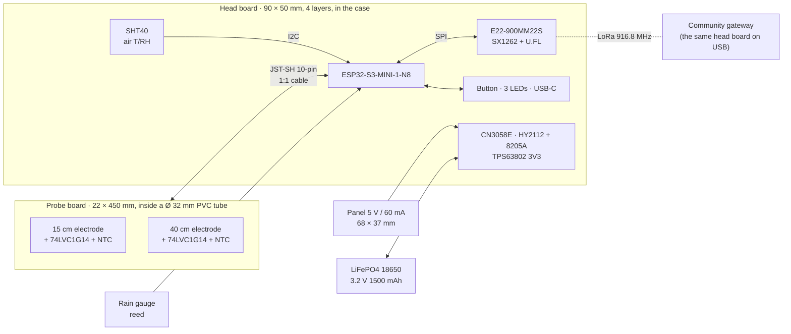

# Gaiapus hardware · soil stake (Rev A)

Hardware reference document. It explains the problem the stake solves, what is on each board and why each component was chosen, how much power it uses and how much it costs. It also shows what has already been verified and what still depends on a prototype.

> **Geographic scope.** The hardware does not depend on any country: the same board works in any region, changing only the radio frequency in configuration (section 4.2). The pilot is in **Uberlândia (MG, Brazil)**, so some numbers are Brazilian: agricultural statistics (IBGE, ANA), radio regulation (Anatel), the climate of the Triângulo Mineiro region and prices in reais. These are always marked **(Brazil)**. Data without that mark applies worldwide or to any installation.

Firmware: [`firmware.md`](firmware.md). Data format: [`protocolo-dados.md`](protocolo-dados.md) (Portuguese). Decisions and reasons: [`decisoes.md`](decisoes.md) (Portuguese; D1–D4, D12, D14, D16–D23). Requirements: [`requisitos-hardware.md`](requisitos-hardware.md) (Portuguese). KiCad project and tools: [`hardware/`](../hardware/README.md). Portuguese version of this document: [`hardware.pt-BR.md`](hardware.pt-BR.md).

---

## 1. Why this hardware exists

Gaiapus recommends the **next crop rotation** and when to plant it without leaving the soil bare. The recommendation starts from NASA data, which covers any place in the world: POWER (radiation, temperature), GPM IMERG (rainfall) and SMAP (soil moisture). This data has limits when deciding on a specific field:

- SMAP measures moisture in **9 km** cells and only in the surface layer (the L4 product estimates the root zone with a model);
- IMERG rainfall is a **≈ 10 km** average, and an isolated summer storm can fall on one farm and miss the neighbour;
- no satellite measures soil temperature **at 15 and 40 cm**, which drives germination and the planting window.

The stake measures exactly that **in the field**: moisture and temperature at two depths, air, local rainfall. The backend uses these readings to calibrate the NASA data for that point. One stake corrects the regional reading for the whole surrounding area. The farmer does not need one stake per hectare.

### For whom

**Worldwide**
- **Family farming**: there are more than 500 million family farms, over 90 % of the world's farms, and they produce about 80 % of the world's food by value (FAO).
- **Water**: agriculture accounts for about 72 % of all freshwater withdrawn on the planet (FAO, AQUASTAT 2025). Irrigating only when the soil needs it saves water and pump energy.

**In Brazil (pilot region)**
- **Family farming (Brazil)**: 77 % of rural establishments (3.9 million), on 23 % of the area (IBGE, Agricultural Census 2017).
- **Little technical assistance (Brazil)**: only about 20 % of establishments received technical guidance in 2017 (IBGE).
- **Water (Brazil)**: irrigation was 50.5 % of all water withdrawn in the country in 2022 (ANA).

Brazil is the test case, not the limit: the same profile (small farm, little technical assistance, rain-fed) repeats across Latin America, Africa and South Asia, where most family farms are.

Today, anyone who wants to measure soil moisture in the field buys scientific sensors costing **hundreds of dollars per depth**, which still need a datalogger and a subscription (section 7.3). That leaves measurement out of reach for those who most need guidance. The hardware goal is to **cost a fraction of that**, run on its own for years with a card-sized panel, and be read through LEDs, with no screen and no phone required.

### What makes the proposal real, not just an idea
| Evidence | Where |
|---|---|
| Complete schematics of both boards, ERC with no errors | `hardware/gaiapus-node`, `hardware/gaiapus-probe` |
| Routed PCBs (head 4 layers 51/51 nets, probe 2 layers 12/12), KiCad DRC with no errors, independent geometric check | section 8 |
| Every component with LCSC code, datasheet in the repository and SMT assembly at JLCPCB | `hardware/datasheets/`, `bom/` |
| Power budget computed from datasheet values | section 6, `power/power_budget.py` |
| Cost of every part with supplier price | `bom/bom_custos_BRL.xlsx` |
| Case and rain gauge designed around the 3D models of the boards, 36/36 checks passed, 0 mm³ interference | `mechanical/` |
| Firmware tested on a PC (9 simulated hours) and a physical bench with the same protocol | [`firmware.md`](firmware.md) |

---

## 2. Overview



There are **two boards** connected by a 10-wire cable (D16):

| Board | Size | Layers | What it carries | Why |
|---|---|---|---|---|
| **Head** (`gaiapus-node`) | 90 × 50 mm | 4 | MCU, radio, power, air sensor, rain gauge, LEDs, button, USB | sits in the case, above ground, with the panel on top |
| **Probe** (`gaiapus-probe`) | 22 × 450 mm | 2 | 2 interdigitated electrodes, 2 oscillators, 2 NTCs | goes into the tube; the oscillator must sit **right next to** the electrode (a long wire adds capacitance and ruins the measurement) |

The head also works as the **gateway**: powered from USB-C, the same board receives over LoRa and publishes over Wi-Fi (D25). There is no second board to design, manufacture and keep in stock.

---

## 3. Requirements and how they are met

| ID | Requirement | How the hardware meets it | Status |
|---|---|---|---|
| F1 | Moisture at 15 and 40 cm, through the tube | copper electrodes on the probe + MHz RC oscillator counted by the PCNT | designed; sensitivity through the wall to be measured on a prototype |
| F2 | Soil temperature at both depths | 10 kΩ 0603 NTC next to each electrode | designed |
| F3 | Air temperature and humidity | SHT40 on an island isolated by a slot in the PCB | designed |
| F4 | Rainfall by pulses, waking the MCU | reed on GPIO17 (RTC), 470 kΩ pull-up + 10 nF | designed |
| F5 | Battery voltage | 2.2 MΩ + 2.2 MΩ divider (0.75 µA) | designed |
| F6, F7 | LoRa uplink every 30 min and command back | E22-900MM22S (SX1262) + U.FL + external antenna | designed |
| F8 | 3 LEDs and 1 button | 0603 LEDs on the front edge + SMD button (also BOOT) | designed |
| F9 | Store and resend without signal | 48-reading queue in the ESP32 RTC RAM (no extra memory) | firmware tested |
| F10 | Programming over USB-C | native ESP32-S3 USB, no converter chip | designed |
| N1 | ≥ 14 days without sun | calculation gives months (section 6) | met with margin |
| N2 | Positive balance on a cloudy day | +51 mAh/day with a 0.3 W panel | met |
| N3 | IP65 | case with silicone bead, cable gland, ePTFE on the vent | mechanics rev G |
| N4 | −5 to +60 °C | LiFePO4 and industrial-range components (−40 to +85 °C) | met per datasheets |
| N5 | 100 % SMD, assemblable at JLCPCB | all SMD; only the battery holder is on the bottom side | met |
| N8 | Certified modules, AU915 band (Brazil) | complete modules (RF matched at the factory); the radio covers 850–930 MHz, so the same board serves AU915 (Brazil, 915–928 MHz), US915 and EU868 | Anatel approval (Brazil) to be confirmed; FCC/CE for other regions |

---

## 4. Component selection

Criteria applied to every part (D1, D12):
1. **SMD soldered directly to the board**, no pin headers or sockets: product look and reliability, automated assembly.
2. **Ready-made radio modules**: a discrete-chip RF layout is risky without a prototype, and a ready module lowers certification cost.
3. **In stock at LCSC/JLCPCB**, so JLCPCB can fabricate and assemble the whole board in a single order.
4. **Low quiescent current**: the stake sleeps 99.9 % of the time, so sleep current decides autonomy.
5. **Lowest cost at 1,000 units**, as long as it does not compromise the items above.

Prices: LCSC, checked in November 2026 (spreadsheet `bom/bom_custos_BRL.xlsx`). "Volume" = 1,000 boards.

### 4.1 Microcontroller: Espressif ESP32-S3-MINI-1-N8 (U4)
LCSC C2913206 · US$ 4.78 (1 unit) / 3.26 (volume) · [datasheet](../hardware/datasheets/ESP32-S3-MINI-1_Espressif.pdf)

| Why this one | Detail |
|---|---|
| Deep sleep at **7–8 µA** | datasheet, table 6-7 (RTC on) |
| **PCNT** (hardware pulse counter) | counts the probe oscillator frequency without using the CPU |
| **Native USB** | flashes and debugs over USB-C without a converter chip (saves a part and board area) |
| **Built-in Wi-Fi** | the same board becomes the gateway (D25) and runs the demo without a gateway (D7) |
| 15.4 × 20.5 mm module with antenna and certification | smaller and cheaper than the WROOM |
| RTC RAM | keeps the 48-reading queue during sleep, no external memory |
| GPIO47/48 at 3.3 V on the N8 (quad flash) version | reads the charger status without a level shifter |

**Rejected:** dev board in a socket (prototype look, D1); ESP32-WROOM (larger and more expensive); STM32WL, which combines MCU and LoRa on one chip and uses less power, but has no Wi-Fi or native USB and needs a custom RF design. The STM32WL stays on the cost roadmap (D5).

### 4.2 Radio: EBYTE E22-900MM22S, SX1262 (U5) + U.FL (J2)
LCSC C5333985 · US$ 3.68 · [manual](../hardware/datasheets/E22-900MM22S_EBYTE_E22-M_UserManual_EN.pdf) · [SX1262](../hardware/datasheets/SX1262_Semtech_SX1261-2_V2.1.pdf)

- **SX1262** (Semtech's current generation): receives at **4.6 mA**, versus about 10 mA for the older SX1276; up to +22 dBm; 0.6 µA sleep with configuration retained.
- **10 × 10 mm**, with 32 MHz crystal, PA and LNA on the module. Note: according to the EBYTE manual, the MM22S version uses a **passive crystal**, not a TCXO (only the larger versions have a TCXO). For LoRa at 125 kHz this is not a problem, but the firmware must configure the radio for a crystal (section 10).
- LoRa at 916.8 MHz, SF9: range of kilometres in rural areas with an external antenna, enough for one **community gateway** to serve several farms.
- **Band per region:** 916.8 MHz is inside the AU915 band used in **Brazil** (915–928 MHz, Anatel). The module operates from 850 to 930 MHz, so the same board serves US915 (USA) and EU868 (Europe, India and much of Africa) by changing only the frequency in firmware and using an 868 or 915 MHz antenna.
- The module has only an antenna **pad** (D14). It goes through a 0 Ω resistor (with two π-match capacitors not fitted, ready for tuning) to a Hirose U.FL (C88374), a 0.35 mm trace over the ground plane, and then by pigtail to an SMA on the case wall.

**Rejected:** E22-900M22S (20 × 14 mm, US$ 6.60, kept as an alternative if stock runs out); SX1276 modules (higher consumption, older design); bare SX1262 chip (RF matching without a prototype).

### 4.3 Power


| Function | Part | LCSC | US$ 1 unit / volume | Why |
|---|---|---|---|---|
| Battery | **LiFePO4 18650** cell, 3.2 V, 1500 mAh, in a MYOUNG BH-18650-B1BA002 SMD holder | C2988620 (holder) | holder 1.48 / 0.94 · cell US$ 7–11 retail | chemistry **without thermal runaway** (the case reaches 60 °C in the sun), ≥ 2,000 cycles, flat 3.2 V. The lower energy density does not matter: the stake uses ~2 mAh/day |
| Charger | **Consonance CN3058E**, linear, made for LiFePO4 (3.6 V) | C112011 | 0.24 / 0.14 | 14 cents; draws < 3 µA from the battery at night. Current set to **51 mA** (R_ISET 24 kΩ), below the 60–69 mA the panel delivers, so the charger does not collapse the panel voltage (D12, `component-selection.md`) |
| Panel protection | **BZT52C6V2** zener | — | 0.02 | the panel Voc (6.0–6.3 V) is close to the CN3058E limit (6.5 V). A 6.2 V zener only conducts at open circuit, when the panel delivers almost no current. A 5.6 V one would burn up to 0.4 W at the operating point |
| USB → charge | **B5819W** Schottky | — | 0.02 | USB-C also charges the battery (bench and gateway) |
| Cell protection | **HYCON HY2112-BB** + **HXY 8205A** dual MOSFET | C161942 · C5148694 | 0.12 + 0.08 | LiFePO4-specific limits: overcharge 3.75 V, deep discharge 2.10 V, short circuit. 3 µA draw. The CN3058E stops at 3.6 V, below the 3.75 V protection, so the two do not fight. The original FS8205A was discontinued and replaced by the pin-compatible 8205A (D17) |
| 3.3 V | **TI TPS63802** buck-boost + 0.47 µH inductor | C2845237 | 0.92 / 0.54 | LiFePO4 goes from 3.6 V to 3.0 V, **on both sides** of 3.3 V. An LDO would drop out below ~3.4 V and lose much of the capacity. The buck-boost regulates across the whole range, with **11 µA** quiescent current and 2 A peak for Wi-Fi and the radio |
| Panel | **5 V / 60 mA, 68 × 37 mm** (0.3 W), ref. AMX Solar SP-68x37 | — | ~5 / ~1 | the smallest one that closes the balance on a cloudy day (section 6). Fits in the lid, behind the button |

**Rejected:** standard Li-ion (3.7 V; suffers in heat and needs a 4.2 V charger); MPPT charger (costs more than it gains on a 0.3 W panel); LDO for 3.3 V (wastes the useful LiFePO4 range); 1 W panel (unnecessary: the 0.3 W panel produces more than 100 times the daily consumption); 6 V panels with 7–8 V Voc (above the charger limit).

### 4.4 Soil moisture: PCB electrode + 74LVC1G14 oscillator (probe)
| Part | LCSC | US$ 1 unit / volume | Function |
|---|---|---|---|
| 2 interdigitated copper electrodes (9 fingers of 2 mm, 2.5 mm gap, under solder mask) | — | zero cost: they are the board's own copper | capacitor whose dielectric is the soil |
| 2 × Nexperia **74LVC1G14** (Schmitt inverter) + 47 kΩ | C131093 | 0.12 / 0.08 | 0.5–2 MHz RC oscillator |
| 2 × 100 Ω in series + test point | — | — | protects the output on the cable and allows measuring the frequency during assembly |

How it works (D4): the electrode and the resistor form an oscillator. Wetter soil has more capacitance, and the frequency drops. A frequency signal travels 40 cm of trace and the cable without losing accuracy, unlike a weak analogue voltage. The ESP32 counts pulses for 10 ms (`firmware.md` § 4.1).

| Why this way | Rejected alternative |
|---|---|
| **No metal in contact with the soil**: the electrode is inside the tube, under solder mask and resin. It does not corrode or wear when the stake is driven in | resistive sensor (corrodes in weeks, varies with fertiliser) |
| **MHz** reduces the effect of soil salinity, compared with the ESP32 touch sensor (kHz) | direct touch input with a long trace (the trace itself measures moisture) |
| Oscillator **right next to** the electrode, powered from a GPIO only during the reading (no sleep current, no load switch) | oscillator on the head with a wire to the electrode (wire capacitance dominates) |
| It is the principle of commercial tube profile probes, with 2 logic gates costing cents | commercial sensor per depth (section 7.3) |

**Declared risk:** sensitivity **through the tube wall** still has to be measured. The test plan is the frequency curve in dry, moist and saturated Latosol (Oxisol). If the wall attenuates too much, plan B is to open windows in the tube, without changing the PCB.

### 4.5 Soil temperature: Murata NCP18XH103F03RB (probe)
LCSC C13564 · US$ 0.05 / 0.03 · 10 kΩ, B 3380 K, 1 %, 0603

- One NTC next to each electrode. It measures soil temperature (germination, planting window) and **compensates** the oscillator's thermal drift.
- Divider with 10 kΩ powered from a GPIO only during the reading: zero sleep current.
- The part is marked "not recommended for new designs". Any 10 kΩ / B 3380 / 1 % 0603 NTC fits without changing the board (open item in section 10).

### 4.6 Air: Sensirion SHT40-AD1B-R2 (U6)
LCSC C2909890 · US$ 1.72 · ±0.2 °C and ±1.8 %RH typical · 0.08 µA idle

- Frost and heat risk for the crop, and dew point for fungal diseases.
- Sits on an **island** separated from the rest of the board by a 1 mm L-shaped slot, so heat from the regulator and radio does not reach the sensor. In the case, it sits behind a vent with an ePTFE membrane.
- **Rejected:** DHT22 (used only on the bench; larger, less accurate, no robust CRC, higher consumption).

### 4.7 Rainfall: tipping-bucket rain gauge with reed (J4)
- Draws nothing when idle. Each tip closes the reed, which **wakes** the ESP32 via GPIO17 (RTC); it counts and goes back to sleep.
- 470 kΩ pull-up: it only draws current (7 µA) if the magnet stops over the reed, and the firmware detects that case (`firmware.md` § 3).
- Measures rainfall **in that field**, which the satellite (≈ 10 km) cannot resolve.
- Designed in mechanics rev G: 100 mm collector, **0.201 mm per pulse** (1.58 mL per tip, computed from the bucket model), adjustable with two M3 stop screws.

### 4.8 Interface and connectors
| Part | LCSC | Why |
|---|---|---|
| HRO **TYPE-C-31-M-12** USB-C + 2 × 5.1 kΩ on CC | C165948 | flashing, debugging and gateway power; ordinary USB-C chargers work thanks to the CC resistors |
| ST **USBLC6-2SC6** | C7519 | ESD protection of the USB lines (the connector is exposed in the field) |
| 3 × 0603 LEDs green, yellow, red + 470 Ω | — | universal language, no screen or reading. Lit only on demand (`firmware.md` § 10) |
| C&K **PTS810** button | C116501 | also the BOOT pin (emergency flashing) |
| JST **SM10B-SRSS-TB** (10-pin, one on each board) | C160409 | head ↔ probe, with GND between the two frequency lines |
| JST **SM02B-SRSS-TB** (panel and rain gauge) | C160402 | same family, locking, low profile |

Full pinout: [`hardware-pinmap.md`](hardware-pinmap.md).

---

## 5. Boards

### 5.1 Head: 90 × 50 mm, 4 layers (D18, D20, D21)
| Layer | Use |
|---|---|
| F.Cu | components and signals |
| In1.Cu | **solid GND plane**: RF trace reference, converter return, shielding |
| In2.Cu | +3V3 plane (continuous over 85 % of the board) and a few short signals |
| B.Cu | signals and battery holder |

- **Why 4 layers:** on 2 layers routing stalled at 50 of 52 nets with 188 vias, a fragmented ground and no reference plane for the antenna. On 4 layers all 51 nets were routed and every GND and +3V3 pin has a direct via to its plane. At JLCPCB, 4 layers cost only a little more than 2 at this size, and the gain in RF and noise is worth it.
- **Connection-driven placement** (`place_head.py`): ESP32 in the corner with the antenna at the edge and no copper underneath (on all 4 layers); converter in the centre, with a short switching loop; LoRa in the opposite corner, with a straight ~4 mm RF path to the U.FL; battery protection next to the negative terminal; front edge with USB-C, connectors, LEDs and button, aligned with the case openings.
- 58 components, all on the top side except the 18650 holder (bottom side, so the battery sits under the board).

### 5.2 Probe: 22 × 450 mm, 2 layers (D16, D18, D19)
- 22 mm wide to fit inside 32 mm PVC (~27 mm inner diameter) with room for resin.
- Electrodes at 170 and 420 mm from the top edge = **15 and 40 cm** deep, with the soil surface 20 mm below the edge.
- **No copper plane behind the electrodes**: a plane there would steal the electric field from the soil and the sensitivity. That is why the probe has 2 layers, with GND pour on both sides outside the electrode area.
- 19 components, all on one side. JLCPCB accepts single boards up to 400 × 500 mm.

### 5.3 Verification
| Check | Head | Probe |
|---|---|---|
| ERC (KiCad) | 0 errors | 0 errors |
| Schematic × netlist connectivity (`check_kicad.py`) | OK | OK |
| Pads × pins of each LCSC symbol (`apply_lcsc.py`) | OK | OK |
| Routed nets | 51/51 | 12/12 |
| DRC (KiCad, JLCPCB rules in `.kicad_dru`) | 0 errors | 0 errors |
| Independent geometric check (`verify_pcb.py`) | 0 violations | 0 violations |
| Board × case clearances and 3D interference (`mechanical/`, rev G) | 36/36 OK, 0 mm³ | — |

The design rules follow JLCPCB capabilities and add specific rules: wide power traces, RF isolation, electrodes isolated from the pour and solid ground connection at the module and USB.

---

## 6. Power budget

### 6.1 Sleep consumption (what matters most)
| Component | Current | Source |
|---|---|---|
| ESP32-S3 in deep sleep (RTC on) | 7–8 µA | Espressif datasheet, table 6-7 |
| TPS63802 (quiescent) | 11 µA | TI datasheet |
| HY2112-BB | 3 µA (max 6) | HYCON datasheet |
| CN3058E without sun | < 3 µA | Consonance datasheet |
| Battery divider 2.2 + 2.2 MΩ | 0.75 µA | 3.3 V / 4.4 MΩ |
| SX1262 asleep with configuration | 0.6–1.2 µA | Semtech datasheet, table 3-5 |
| SHT40 idle | 0.08 µA | Sensirion datasheet |
| Probe oscillators and NTCs | 0 | unpowered during sleep |
| **Total** | **≈ 26 µA** (**28 µA** used) | |

### 6.2 Each measurement cycle (every 30 min)
| Step | Current | Time |
|---|---|---|
| Read the sensors | ESP32 active ≈ 35 mA | ≈ 0.1 s |
| Transmit 25 bytes (SF9, 14 dBm) | ≈ 35 + 65 mA (SX1262 at 14 dBm: 63 mA, table 3-6) | 0.206 s |
| Wait for the acknowledgement | ≈ 35 + 5 mA | 0.4 s typical / 1.5 s worst case |

### 6.3 Result (`power/power_budget.py`)
```
python power/power_budget.py --sleep-ua 28 --mcu-ma 35 --tx-ma 65 --rx-s 1.5 --medir-s 0.1 --painel-w 0.3
```
| | Typical | Worst case (1.5 s window) |
|---|---|---|
| Charge per cycle | 11 µAh | 23 µAh |
| **Consumption per day** | **1.2 mAh** (50 µA average) | **1.8 mAh** (75 µA average) |
| Generation on a sunny day (0.3 W, 4.5 peak sun hours) | 211 mAh/day | 211 mAh/day |
| Generation on a cloudy day (25 %) | 53 mAh/day | 53 mAh/day |
| **Balance on a cloudy day** | **+52 mAh/day** | **+51 mAh/day** |

Other scenarios: measuring every 15 min, 2.9 mAh/day; transmitting at 22 dBm, 1.9 mAh/day. Both still have a positive balance.

**What this means:**
- The stake uses less per day than **the cell's own natural self-discharge** (~1.5 mAh/day). With a full battery and no sun at all, the calculation gives about **one year**. Target N1 was 14 days.
- One day of consumption is replaced by **about 2 minutes** of charging at 51 mA.
- The 0.3 W panel produces **more than 100 times** the daily consumption on a sunny day. It was sized for the **cloudy day** and for dirt and shade in the field, not for the average.
- The peak sun hours used (4.5 h) are conservative for the Triângulo Mineiro **(Brazil)**. The exact worst-month value for any location comes from **NASA POWER** (parameter `ALLSKY_SFC_SW_DWN`), the same data the app already uses: the hardware sizing also relies on NASA data.
- **Other regions:** generation falls in proportion to the sun hours. With 1.5 peak sun hours (winter at high latitudes, such as northern Europe), the panel produces ~70 mAh/day and ~18 mAh/day when cloudy, still 10 times the consumption. The same panel works in practically any farming area in the world.

**Choices that reduce consumption:** deep sleep between measurements; sensors powered from GPIOs only during the reading (no load switch); one oscillator at a time; LoRa instead of Wi-Fi in the field; LEDs lit only on demand (blinking every few seconds would almost double consumption, `firmware.md` § 10); 25-byte packet (206 ms on air).

---

## 7. Cost and cost-benefit

### 7.1 Components per stake
Prices from LCSC, a global supplier that sells in US dollars. Values in reais **(Brazil)** use an exchange rate of R$ 5.04 and **do not include** Brazilian shipping or import taxes. The reference value for comparing across countries is the US$ value.

| Item | 1 unit (US$) | Volume of 1,000 (US$) | 1 unit (R$, Brazil) | Volume (R$, Brazil) |
|---|---|---|---|---|
| Head electronics (40 BOM lines) | 14.73 | 11.45 | 74.24 | 57.69 |
| Probe electronics | 0.79 | 0.48 | 3.99 | 2.44 |
| 0.3 W solar panel | 4.96 | ~1 (to be confirmed) | 25.00 | ~5 |
| LiFePO4 18650 cell | 7–11 (retail) | to be quoted | ~35–55 | to be quoted |
| **Subtotal with price** | **≈ 28–32** | **≈ 13 + cell** | **≈ 140–160** | **≈ 65 + cell** |
| PCB for both boards, SMT assembly, cable, case and tube | to be quoted | to be quoted | to be quoted | to be quoted |

Where the head's money goes (volume): ESP32-S3 (US$ 3.26) and radio (US$ 3.68) are 61 % of the electronics. SHT40 (US$ 1.72), battery holder (US$ 0.94) and TPS63802 (US$ 0.54) follow. The other 35 lines add up to less than US$ 1.40. The whole probe costs less than **US$ 0.50** in components, because the moisture sensor is the board's own copper.

### 7.2 Where cost can come down
- **Single MCU + LoRa SoC** (e.g. STM32WL): removes one of the two modules (≈ US$ 3) and reduces consumption (D5). Requires a custom RF design, so it comes after the first prototype.
- Panel and cell bought directly from the factory in volume.
- The gateway is the same board: a cooperative buys a gateway for the cost of a stake, and it serves every stake in range.

### 7.3 Comparison with commercial sensors
| Solution | What it measures | Reference price |
|---|---|---|
| METER TEROS 12 | moisture, temperature and EC at **1 depth** | US$ 258 (5 m cable), datalogger extra |
| METER TEROS 54 | profile moisture, 4 depths | US$ 890, datalogger extra |
| Onset HOBOnet T12 (wireless) | 1 depth | US$ 549–615 per sensor, plus base station |
| **Gaiapus stake** | moisture and temperature at **2 depths** + air + rain + radio + solar | **≈ US$ 30 in components** (1 unit), less in volume |

This is an **order-of-magnitude** comparison and must be read honestly:
- Commercial sensors come calibrated for most soils and have research-grade accuracy. The Gaiapus stake is calibrated in two steps: air and water at the factory, and soil type in the backend. Its purpose is to **decide** (irrigate or not, plant now or wait), not to do soil-physics research.
- The stake price above is for **components**, not a retail price. A final product costs a few times the BOM. Even so, it stays an order of magnitude below a single commercial sensor with a logger.

### 7.4 Why it is worth it
- **One stake calibrates the NASA data** for the field. Without hardware, the farmer already uses the app (tier 0). With a stake, the recommendation reflects their own soil.
- **No running cost**: no SIM card, no subscription, no battery replacement. LoRa uses licence-free ISM spectrum (in any country, in the regional band) and the gateway is shared by the community. This matters where there is no mobile coverage in the field.
- **Almost zero maintenance**: no metal in contact with the soil, long-life cell, industrial-range components.
- **Accessible to those who do not read or use apps**: green, yellow and red LEDs and WhatsApp voice messages.

---

## 8. Assembly, manufacturing and testing

- **Manufacturing:** JLCPCB. Head on 4 layers (JLC04161H-7628 stack-up, 1.6 mm); probe on 2 layers, 450 mm. Every part has an LCSC code, for SMT assembly in the same order.
- **Minimal hand assembly:** the 18650 holder (bottom side) and the cables (panel, rain gauge, probe).
- **Probe:** glued to the inner wall of the tube and potted in resin (no air between electrode and wall).
- **Factory calibration:** diagnostic mode over USB, reading with the probe in **air** and in **water** (`firmware.md` § 9). The two points of each probe go to the backend.
- **First power-up (bring-up):** checklist in `firmware/README.md`: 3.3 V and sleep current (target < 30 µA), USB, SHT40, oscillator frequency at the test points, radio initialisation (crystal) and LoRa transmission, charging from the panel.

---

## 9. Mechanics (summary, details in D23 and `mechanical/`)
- **Rev G** (current). Head case of **114 × 88 mm** in printed parts (base with collar, lid, button, plunger, light bar), top sloped 15° (104 mm rear / 80.4 mm front), M3 screws from below, silicone bead on the seam.
- Panel in the lid recess; button on the panel axis and LED bar in front of it, with the LEDs carried by light pipes.
- USB-C with a silicone cap; antenna SMA on the rear wall; ePTFE vent next to the SHT40; M8 cable gland for the rain gauge.
- 32 mm PVC tube centred under the head; the probe cable runs up inside the tube.
- **Rain gauge:** tipping bucket with a 100 mm collector (0.201 mm per pulse), mounted on a two-piece clamp around the neck, with its rim 1 mm above the head top so the head casts no rain shadow.
- 36 clearance and interference checks, all OK (`mechanical/drawings/checks-revG.md`).

---

## 10. Risks and open items

| Topic | Status | Next step |
|---|---|---|
| Moisture through the tube wall | assumption without prototype | curve in dry/moist/saturated Latosol; plan B: windows in the tube |
| 50 Ω RF trace | 0.35 mm estimated | confirm with the JLCPCB impedance calculator; tune the π-match with a network analyser |
| Stock | Nexperia 74LVC1G14 and green/yellow LEDs out of stock at LCSC; HY2112 and E22 low stock | 74LVC1G14 has a pin-compatible second source (e.g. TI SN74LVC1G14DBVR); 0603 LEDs are generic; E22-900M22S as radio alternative |
| NTC discontinued | NRND | equivalent 10 kΩ / B 3380 / 1 % in 0603 |
| 3D models | button, 2-pin JST connectors and inductor without a model in the KiCad library | replaced by LCSC parts with models (PTS810 C116501, SM02B C160402, Coilcraft XFL4015-471 inductor C18221164), awaiting import |
| Radio oscillator | the E22-900MM22S has a passive crystal, but the firmware configures TCXO first (it works through the fallback path, which tries the crystal if the TCXO fails) | configure the crystal directly in `config.h` and fix `firmware.md` § 6.1 |
| Certification | ready-made modules | Anatel **(Brazil)** for the pilot; FCC (USA) and CE/RED (Europe) for other regions |
| Final cost | PCB, assembly, cable, case and cell to be quoted | JLCPCB quote for 10 and 1,000 units |
| Height of the 18650 holder with cell | 21 mm assumed | measure on first assembly |

---

## 11. Hardware roadmap
| Rev | Change | Gain |
|---|---|---|
| A (this project) | ESP32-S3 + E22, LoRa P2P, 2 depths | working prototype with off-the-shelf parts |
| B | LoRaWAN AU915; accelerometer or GPS if movement detection is needed | public network, security (AES), theft detection |
| C | single MCU + LoRa SoC (STM32WL); internal antenna | lower cost, lower consumption, fewer fragile parts |

---

## 12. File map
```
hardware/
├── gaiapus-node/            head: schematic, 4-layer PCB, JLCPCB rules (.kicad_dru)
├── gaiapus-probe/           probe: schematic, 2-layer PCB, rules
├── lib/                     generated symbols, parametric electrode, LCSC footprints and 3D
├── datasheets/              datasheet of every main component
└── tools/                   generation, placement, routing and verification (hardware/README.md)
bom/
├── bom_from_schematic.csv   BOM exported from the schematic (per board)
└── bom_custos_BRL.xlsx      price of each line, 1 unit and volume
power/power_budget.py        power budget (command-line parameters)
mechanical/                  case and rain gauge rev G, drawings and clearance report
docs/
├── hardware.md              this document (Portuguese: hardware.pt-BR.md)
├── component-selection.md   component research and calculated values
├── hardware-pinmap.md       ESP32 pins and nets
└── decisoes.md              decision log (Portuguese)
```

---

## Sources
**Worldwide**
- FAO, [Family Farming Knowledge Platform](https://www.fao.org/family-farming/background/en) (family farms and food production)
- FAO, [AQUASTAT Water Data Snapshot 2025](https://news.un.org/en/story/2025/12/1166582) (freshwater withdrawal by agriculture)
- NASA POWER, [power.larc.nasa.gov](https://power.larc.nasa.gov/) (solar irradiance used to size the panel)

**Brazil**
- IBGE, Agricultural Census 2017: [family farming and employed population](https://agenciadenoticias.ibge.gov.br/agencia-sala-de-imprensa/2013-agencia-denoticias/releases/25789-censo-agro-2017-populacao); [technical assistance (Atlas Rural)](https://www.ibge.gov.br/apps/atlasrural/pdfs/05_00_Texto.pdf)
- ANA, [Conjuntura dos Recursos Hídricos 2023](https://agenciagov.ebc.com.br/noticias/202402/relatorio-conjuntura-dos-recursos-hidricos-no-brasil-atualiza-informacoes-sobre-aguas-do-pais) (water withdrawal by use, 2022)

**Prices and components**
- METER Group, [2025 price list](https://library.metergroup.com/Sales%20and%20Support/G.A%20Harris%20Price%20List.pdf) (TEROS 12, TEROS 54)
- Onset, [HOBOnet T12](https://www.onsetcomp.com/products/sensors/rxw-t12-xxx); [MicroDAQ](https://microdaq.com/onset-hobonet-wireless-t12-soil-moisture-electrical-conductivity-temp-sensor.php)
- LiFePO4 18650 1500 mAh cell: [BatterySpace LFP-18650-1500](https://www.batteryspace.com/LiFePO4-18650-Rechargeable-Cell-3.2V-1500-mAh-4.8Wh-7.5A-Rate.aspx)
- Component datasheets: `hardware/datasheets/` (Espressif, Semtech, EBYTE, TI, HYCON, Consonance, Sensirion, Nexperia, Murata, ST, HRO, Hirose, JST)
- Component prices: LCSC, November 2026 (`bom/bom_custos_BRL.xlsx`)
