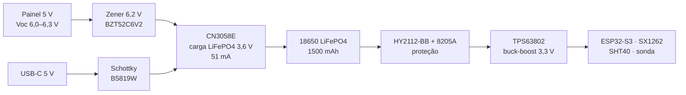

# Hardware Gaiapus · estaca de solo (Rev A)

Documento de referência do hardware. Explica o problema que a estaca resolve, o que tem em cada placa e por que cada componente foi escolhido, quanto ela consome e quanto custa. Mostra também o que já foi verificado e o que ainda depende de protótipo.

> **Escopo geográfico.** O hardware não depende de país: a mesma placa funciona em qualquer região, trocando só a frequência do rádio por configuração (seção 4.2). O piloto é em **Uberlândia (MG, Brasil)**, por isso alguns números são brasileiros: estatísticas agrícolas (IBGE, ANA), norma de rádio (Anatel), clima do Triângulo Mineiro e preços em reais. Esses dados aparecem sempre marcados como **(Brasil)**. Os dados sem essa marca valem para o mundo ou para qualquer instalação.

Firmware: [`firmware.md`](firmware.md). Formato dos dados: [`protocolo-dados.md`](protocolo-dados.md). Decisões e motivos: [`decisoes.md`](decisoes.md) (D1–D4, D12, D14, D16–D23). Requisitos: [`requisitos-hardware.md`](requisitos-hardware.md). Projeto KiCad e ferramentas: [`hardware/`](../hardware/README.md).

---

## 1. Por que este hardware existe

O Gaiapus recomenda a **próxima rotação de culturas** e o momento de plantar sem deixar o solo descoberto. A recomendação parte de dados da NASA, que cobrem qualquer lugar do mundo: POWER (radiação, temperatura), GPM IMERG (chuva) e SMAP (umidade do solo). Esses dados têm limites para decidir num talhão específico:

- o SMAP mede umidade em células de **9 km** e só na camada superficial (o produto L4 estima a zona das raízes por modelo);
- a chuva do IMERG é uma média de **≈ 10 km**, e uma pancada isolada de verão pode cair num sítio e não no vizinho;
- nenhum satélite mede a temperatura do solo **a 15 e 40 cm**, que decide germinação e janela de plantio.

A estaca mede exatamente isso **no talhão**: umidade e temperatura em duas profundidades, ar, chuva local. O backend usa essas leituras para calibrar o dado da NASA para aquele ponto. Uma estaca corrige a leitura regional de toda a área em volta. O produtor não precisa de uma estaca por hectare.

### Para quem

**No mundo**
- **Agricultura familiar**: há mais de 500 milhões de propriedades familiares, mais de 90 % das fazendas do mundo, e elas produzem cerca de 80 % dos alimentos em valor (FAO).
- **Água**: a agricultura responde por cerca de 72 % de toda a água doce retirada no planeta (FAO, AQUASTAT 2025). Irrigar só quando o solo pede economiza água e energia de bomba.

**No Brasil (região do piloto)**
- **Agricultura familiar (Brasil)**: 77 % dos estabelecimentos rurais (3,9 milhões), em 23 % da área (IBGE, Censo Agro 2017).
- **Pouca assistência técnica (Brasil)**: só cerca de 20 % dos estabelecimentos recebiam orientação técnica em 2017 (IBGE).
- **Água (Brasil)**: a irrigação foi 50,5 % de toda a água retirada no país em 2022 (ANA).

O Brasil é o caso de teste, não o limite: o mesmo perfil (propriedade pequena, pouca assistência técnica, dependência de chuva) se repete na América Latina, na África e no Sul da Ásia, onde estão a maioria das propriedades familiares.

Hoje, quem quer medir umidade do solo no campo compra sensores científicos de **centenas de dólares por profundidade**, que ainda precisam de datalogger e assinatura (seção 7.3). Isso deixa a medição de fora para quem mais precisa de orientação. A meta do hardware é **custar uma fração disso**, funcionar sozinho por anos com um painel do tamanho de um cartão e ser lido por LEDs, sem precisar de tela nem de celular.

### O que torna a proposta real, e não só uma ideia
| Prova | Onde |
|---|---|
| Esquemático completo das duas placas, ERC sem erros | `hardware/gaiapus-node`, `hardware/gaiapus-probe` |
| PCBs roteadas (cabeça 4 camadas 51/51 redes, sonda 2 camadas 12/12), DRC do KiCad sem erros, verificação geométrica independente | seção 8 |
| Todos os componentes com código LCSC, datasheet no repositório e montagem SMT pela JLCPCB | `hardware/datasheets/`, `bom/` |
| Orçamento de energia calculado com valores de datasheet | seção 6, `power/power_budget.py` |
| Custo de cada peça com preço consultado no fornecedor | `bom/bom_custos_BRL.xlsx` |
| Case projetado em torno dos modelos 3D das placas, 23/23 folgas conferidas | `mechanical/` |
| Firmware testado no PC (9 h simuladas) e bancada física com o mesmo protocolo | [`firmware.md`](firmware.md) |

---

## 2. Visão geral


São **duas placas** ligadas por um cabo de 10 vias (D16):

| Placa | Tamanho | Camadas | O que leva | Por quê |
|---|---|---|---|---|
| **Cabeça** (`gaiapus-node`) | 90 × 50 mm | 4 | MCU, rádio, energia, sensor de ar, pluviômetro, LEDs, botão, USB | fica no case, acima do solo, com o painel em cima |
| **Sonda** (`gaiapus-probe`) | 22 × 450 mm | 2 | 2 eletrodos interdigitados, 2 osciladores, 2 NTC | entra no tubo; o oscilador precisa ficar **colado** ao eletrodo (fio longo soma capacitância e estraga a medida) |

A cabeça também serve de **gateway**: alimentada pela USB-C, a mesma placa recebe por LoRa e publica por Wi-Fi (D25). Não há uma segunda placa para projetar, fabricar e manter em estoque.

---

## 3. Requisitos e como são atendidos

| ID | Requisito | Como o hardware atende | Situação |
|---|---|---|---|
| F1 | Umidade a 15 e 40 cm, através do tubo | eletrodos de cobre na sonda + oscilador RC de MHz contado pelo PCNT | projetado; sensibilidade através da parede a medir em protótipo |
| F2 | Temperatura do solo nas 2 profundidades | NTC 10 kΩ 0603 ao lado de cada eletrodo | projetado |
| F3 | Temperatura e umidade do ar | SHT40 numa ilha isolada por rasgo na PCB | projetado |
| F4 | Chuva por pulsos, acordando o MCU | reed no GPIO17 (RTC), pull-up 470 kΩ + 10 nF | projetado |
| F5 | Tensão da bateria | divisor 2,2 MΩ + 2,2 MΩ (0,75 µA) | projetado |
| F6, F7 | Envio por LoRa a cada 30 min e comando de volta | E22-900MM22S (SX1262) + U.FL + antena externa | projetado |
| F8 | 3 LEDs e 1 botão | LEDs 0603 na borda frontal + botão SMD (também é o BOOT) | projetado |
| F9 | Guardar e reenviar sem sinal | fila de 48 medições na RAM RTC do ESP32 (sem memória extra) | firmware testado |
| F10 | Programação pela USB-C | USB nativa do ESP32-S3, sem chip conversor | projetado |
| N1 | ≥ 14 dias sem sol | cálculo dá meses (seção 6) | atendido com folga |
| N2 | Saldo positivo em dia nublado | +51 mAh/dia com painel de 0,3 W | atendido |
| N3 | IP65 | case com cordão de silicone, prensa-cabo, ePTFE no respiro | mecânica rev B |
| N4 | −5 a +60 °C | LiFePO4 e componentes de faixa industrial (−40 a +85 °C) | atendido pelos datasheets |
| N5 | 100 % SMD, montável na JLCPCB | todos SMD; só o suporte da bateria fica na face de baixo | atendido |
| N8 | Módulos certificados, faixa AU915 (Brasil) | módulos completos (RF casado de fábrica); o rádio cobre 850–930 MHz, então a mesma placa atende AU915 (Brasil, 915–928 MHz), US915 e EU868 | homologação Anatel (Brasil) a confirmar; FCC/CE para outras regiões |

---

## 4. Escolha dos componentes

Critérios aplicados a todas as peças (D1, D12):
1. **SMD soldado direto na placa**, sem barras de pinos nem soquetes: aparência e confiabilidade de produto, montagem automática.
2. **Módulos prontos para rádio**: o layout de RF de chip solto é arriscado sem protótipo, e um módulo pronto reduz o custo de certificação.
3. **Em estoque no LCSC/JLCPCB**, para a JLCPCB fabricar e montar a placa inteira num só pedido.
4. **Baixa corrente em repouso**: a estaca dorme 99,9 % do tempo, então o consumo em sono decide a autonomia.
5. **Menor custo com 1.000 unidades**, desde que não comprometa os itens acima.

Preços: LCSC, consultados em novembro de 2026 (planilha `bom/bom_custos_BRL.xlsx`). "Lote" = 1.000 placas.

### 4.1 Microcontrolador: Espressif ESP32-S3-MINI-1-N8 (U4)
LCSC C2913206 · US$ 4,78 (1 un.) / 3,26 (lote) · [datasheet](../hardware/datasheets/ESP32-S3-MINI-1_Espressif.pdf)

| Por que este | Detalhe |
|---|---|
| Sono profundo de **7–8 µA** | datasheet, tabela 6-7 (RTC ligado) |
| **PCNT** (contador de pulsos em hardware) | conta a frequência dos osciladores da sonda sem gastar CPU |
| **USB nativa** | grava e depura pela USB-C sem chip conversor (economiza peça e área) |
| **Wi-Fi integrado** | a mesma placa vira gateway (D25) e faz a demonstração sem gateway (D7) |
| Módulo de 15,4 × 20,5 mm com antena e certificação | menor e mais barato que o WROOM |
| RAM RTC | guarda a fila de 48 medições durante o sono, sem memória externa |
| GPIO47/48 em 3,3 V na versão N8 (flash quad) | lê o status do carregador sem conversor de nível |

**Descartados:** placa de desenvolvimento em soquete (aparência de protótipo, D1); ESP32-WROOM (maior e mais caro); STM32WL, que junta MCU e LoRa num chip e consome menos, mas não tem Wi-Fi nem USB nativa e exige projeto de RF próprio. O STM32WL fica no roadmap de custo (D5).

### 4.2 Rádio: EBYTE E22-900MM22S, SX1262 (U5) + U.FL (J2)
LCSC C5333985 · US$ 3,68 · [manual](../hardware/datasheets/E22-900MM22S_EBYTE_E22-M_UserManual_EN.pdf) · [SX1262](../hardware/datasheets/SX1262_Semtech_SX1261-2_V2.1.pdf)

- **SX1262** (geração atual da Semtech): recepção a **4,6 mA**, contra cerca de 10 mA do SX1276 antigo; até +22 dBm; sono de 0,6 µA mantendo a configuração.
- **10 × 10 mm**, com cristal de 32 MHz, PA e LNA no módulo. Atenção: segundo o manual da EBYTE, a versão MM22S usa **cristal passivo**, não TCXO (só as versões maiores têm TCXO). Em LoRa a 125 kHz isso não é problema, mas o firmware precisa configurar o rádio para cristal (seção 10).
- LoRa a 916,8 MHz, SF9: alcance de quilômetros em área rural com antena externa, suficiente para um **gateway comunitário** atender várias propriedades.
- **Faixa por região:** 916,8 MHz está dentro da faixa AU915 usada no **Brasil** (915–928 MHz, Anatel). O módulo opera de 850 a 930 MHz, então a mesma placa serve para US915 (EUA) e EU868 (Europa, Índia e boa parte da África) trocando só a frequência no firmware, com a antena de 868 ou 915 MHz.
- O módulo só tem um **pad** de antena (D14). Ele vai por um resistor 0 Ω (com dois capacitores do casamento em π não montados, prontos para ajuste) até um U.FL Hirose (C88374), trilha de 0,35 mm sobre o plano de terra, e depois por pigtail até um SMA na parede do case.

**Descartados:** E22-900M22S (20 × 14 mm, US$ 6,60, fica como alternativa se faltar estoque); módulos com SX1276 (consomem mais e são de projeto antigo); chip SX1262 solto (casamento de RF sem protótipo).

### 4.3 Energia



| Função | Peça | LCSC | US$ 1 un. / lote | Por que |
|---|---|---|---|---|
| Bateria | célula **LiFePO4 18650**, 3,2 V, 1500 mAh, em suporte SMD MYOUNG BH-18650-B1BA002 | C2988620 (suporte) | suporte 1,48 / 0,94 · célula US$ 7–11 no varejo | química **sem fuga térmica** (o case fica a 60 °C ao sol), ≥ 2.000 ciclos, tensão plana 3,2 V. A densidade de energia menor não importa: a estaca usa ~2 mAh/dia |
| Carregador | **Consonance CN3058E**, linear, feito para LiFePO4 (3,6 V) | C112011 | 0,24 / 0,14 | 14 centavos; consome < 3 µA da bateria à noite. Corrente fixada em **51 mA** (R_ISET 24 kΩ), abaixo dos 60–69 mA que o painel entrega, para o carregador não derrubar a tensão do painel (D12, `component-selection.md`) |
| Proteção do painel | zener **BZT52C6V2** | — | 0,02 | o Voc do painel (6,0–6,3 V) fica perto do limite do CN3058E (6,5 V). Um zener de 6,2 V só conduz em circuito aberto, quando o painel quase não tem corrente. Um de 5,6 V queimaria até 0,4 W no ponto de trabalho |
| USB → carga | Schottky **B5819W** | — | 0,02 | a USB-C também carrega a bateria (bancada e gateway) |
| Proteção da célula | **HYCON HY2112-BB** + MOSFET duplo **HXY 8205A** | C161942 · C5148694 | 0,12 + 0,08 | limites próprios de LiFePO4: sobrecarga 3,75 V, descarga profunda 2,10 V, curto. Consumo de 3 µA. O CN3058E para em 3,6 V, abaixo dos 3,75 V da proteção, então os dois não brigam. O FS8205A original saiu de linha e foi trocado pelo 8205A de mesma pinagem (D17) |
| 3,3 V | **TI TPS63802** buck-boost + indutor 0,47 µH | C2845237 | 0,92 / 0,54 | a LiFePO4 vai de 3,6 V a 3,0 V, **dos dois lados** de 3,3 V. Um LDO deixaria de regular abaixo de ~3,4 V e perderia boa parte da capacidade. O buck-boost regula a faixa inteira, com **11 µA** de consumo próprio e 2 A de pico para o Wi-Fi e o rádio |
| Painel | **5 V / 60 mA, 68 × 37 mm** (0,3 W), ref. AMX Solar SP-68x37 | — | ~5 / ~1 | o menor que fecha o balanço em dia nublado (seção 6). Cabe na tampa, atrás do botão |

**Descartados:** Li-ion comum (3,7 V; sofre com calor e precisa de carregador 4,2 V); carregador MPPT (custa mais que o ganho num painel de 0,3 W); LDO para 3,3 V (desperdiça a faixa útil da LiFePO4); painel de 1 W (desnecessário: o painel de 0,3 W gera mais de 100 vezes o consumo diário); painéis de 6 V com Voc de 7–8 V (acima do limite do carregador).

### 4.4 Umidade do solo: eletrodo na PCB + oscilador 74LVC1G14 (sonda)
| Peça | LCSC | US$ 1 un. / lote | Função |
|---|---|---|---|
| 2 eletrodos interdigitados de cobre (9 dedos de 2 mm, folga 2,5 mm, sob máscara de solda) | — | custo zero: são cobre da própria PCB | capacitor cujo dielétrico é o solo |
| 2 × Nexperia **74LVC1G14** (inversor Schmitt) + 47 kΩ | C131093 | 0,12 / 0,08 | oscilador RC de 0,5–2 MHz |
| 2 × 100 Ω em série + ponto de teste | — | — | protege a saída no cabo e permite medir a frequência na montagem |

Como funciona (D4): o eletrodo e o resistor formam um oscilador. Solo mais úmido tem mais capacitância, e a frequência cai. O sinal de frequência atravessa 40 cm de trilha e o cabo sem perder precisão, ao contrário de uma tensão analógica fraca. O ESP32 conta os pulsos por 10 ms (`firmware.md` § 4.1).

| Por que assim | Alternativa descartada |
|---|---|
| **Sem metal em contato com o solo**: o eletrodo fica dentro do tubo, sob máscara e resina. Não corrói nem desgasta ao cravar | sensor resistivo (corrói em semanas, varia com o adubo) |
| **MHz** reduz o efeito da salinidade do solo, comparado com o touch do ESP32 (kHz) | touch direto com trilha longa (a própria trilha mede umidade) |
| Oscilador **colado** ao eletrodo, alimentado por GPIO só durante a leitura (sem consumo em sono, sem chave de carga) | oscilador na cabeça com fio até o eletrodo (capacitância do fio domina) |
| É o princípio das sondas comerciais de perfil em tubo, com 2 portas lógicas de centavos | sensor comercial por profundidade (seção 7.3) |

**Risco declarado:** a sensibilidade **através da parede do tubo** ainda precisa ser medida. O plano de teste é a curva de frequência em Latossolo seco, úmido e saturado. Se a parede atenuar demais, o plano B é abrir janelas no tubo, sem mudar a PCB.

### 4.5 Temperatura do solo: Murata NCP18XH103F03RB (sonda)
LCSC C13564 · US$ 0,05 / 0,03 · 10 kΩ, B 3380 K, 1 %, 0603

- Um NTC ao lado de cada eletrodo. Mede a temperatura do solo (germinação, janela de plantio) e **compensa** a deriva térmica do oscilador.
- Divisor com 10 kΩ alimentado por GPIO só durante a leitura: zero consumo em sono.
- A peça está marcada "não recomendada para projetos novos". Qualquer NTC 10 kΩ / B 3380 / 1 % em 0603 serve sem mudar a placa (pendência da seção 10).

### 4.6 Ar: Sensirion SHT40-AD1B-R2 (U6)
LCSC C2909890 · US$ 1,72 · ±0,2 °C e ±1,8 %UR típicos · 0,08 µA em repouso

- Risco de geada e de calor na planta, e ponto de orvalho para doenças fúngicas.
- Fica numa **ilha** separada do resto da placa por um rasgo em L de 1 mm. Assim o calor do regulador e do rádio não chega ao sensor. No case, fica atrás de um respiro com membrana de ePTFE.
- **Descartado:** DHT22 (usado só na bancada; maior, menos preciso, sem CRC robusto, consumo maior).

### 4.7 Chuva: pluviômetro de báscula com reed (J4)
- Não consome nada parado. Cada báscula fecha o reed, que **acorda** o ESP32 pelo GPIO17 (RTC), e ele conta e volta a dormir.
- Pull-up de 470 kΩ: só gasta corrente (7 µA) se o ímã parar sobre o reed, e o firmware detecta esse caso (`firmware.md` § 3).
- Mede a chuva **naquele talhão**, que o satélite (≈ 10 km) não resolve.

### 4.8 Interface e conectores
| Peça | LCSC | Por que |
|---|---|---|
| USB-C HRO **TYPE-C-31-M-12** + 2 × 5,1 kΩ nos CC | C165948 | gravação, depuração e alimentação do gateway; carregadores USB-C comuns funcionam por causa dos resistores de CC |
| ST **USBLC6-2SC6** | C7519 | proteção ESD das linhas USB (o conector fica exposto no campo) |
| 3 LEDs 0603 verde, amarelo, vermelho + 470 Ω | — | linguagem universal, sem tela nem leitura. Acendem só sob demanda (`firmware.md` § 10) |
| Botão C&K **PTS810** | C116501 | também é o pino BOOT (gravação de emergência) |
| JST **SM10B-SRSS-TB** (10 vias, uma em cada placa) | C160409 | cabeça ↔ sonda, com GND entre as duas linhas de frequência |
| JST **SM02B-SRSS-TB** (painel e pluviômetro) | C160402 | mesma família, travado, baixo perfil |

Pinagem completa: [`hardware-pinmap.md`](hardware-pinmap.md).

---

## 5. Placas

### 5.1 Cabeça: 90 × 50 mm, 4 camadas (D18, D20, D21)
| Camada | Uso |
|---|---|
| F.Cu | componentes e sinais |
| In1.Cu | **plano de GND inteiro**: referência da trilha de RF, retorno do conversor, blindagem |
| In2.Cu | plano de +3V3 (contínuo em 85 % da placa) e alguns sinais curtos |
| B.Cu | sinais e suporte da bateria |

- **Por que 4 camadas:** em 2 camadas o roteamento parou em 50 de 52 redes com 188 vias, terra recortado e sem plano de referência para a antena. Em 4 camadas, todas as 51 redes foram roteadas e todo pino de GND e +3V3 tem via direta ao plano. Na JLCPCB, 4 camadas custam pouco a mais que 2 nesse tamanho, e o ganho em RF e em ruído compensa.
- **Posicionamento guiado pelas conexões** (`place_head.py`): ESP32 no canto com a antena na borda e sem cobre embaixo (nas 4 camadas); conversor no centro, com o laço de chaveamento curto; LoRa no canto oposto, com caminho de RF reto de ~4 mm até o U.FL; proteção da bateria junto ao polo negativo; borda frontal com USB-C, conectores, LEDs e botão, alinhados às aberturas do case.
- 58 componentes, todos na face de cima, menos o suporte da 18650 (face de baixo, para a bateria ficar sob a placa).

### 5.2 Sonda: 22 × 450 mm, 2 camadas (D16, D18, D19)
- Largura de 22 mm para caber no PVC de 32 mm (diâmetro interno ~27 mm) com folga para a resina.
- Eletrodos a 170 e 420 mm da borda superior = **15 e 40 cm** de profundidade, com a superfície do solo 20 mm abaixo da borda.
- **Sem plano de cobre atrás dos eletrodos**: um plano ali roubaria o campo elétrico do solo e a sensibilidade. Por isso a sonda tem 2 camadas, com GND em pour nas duas faces fora da área dos eletrodos.
- 19 componentes, todos de um lado. A JLCPCB aceita placa única até 400 × 500 mm.

### 5.3 Verificação
| Verificação | Cabeça | Sonda |
|---|---|---|
| ERC (KiCad) | 0 erros | 0 erros |
| Conectividade esquemático × netlist (`check_kicad.py`) | OK | OK |
| Pads × pinos de cada símbolo LCSC (`apply_lcsc.py`) | OK | OK |
| Redes roteadas | 51/51 | 12/12 |
| DRC (KiCad, regras JLCPCB em `.kicad_dru`) | 0 erros | 0 erros |
| Verificação geométrica independente (`verify_pcb.py`) | 0 violações | 0 violações |
| Folgas placa × case (`mechanical/`) | 23/23 OK | — |

As regras de projeto seguem a capacidade da JLCPCB e somam regras específicas: trilhas de potência largas, isolamento de RF, eletrodos isolados do pour e ligação sólida ao terra no módulo e no USB.

---

## 6. Custo energético

### 6.1 Consumo em sono (o que mais pesa)
| Componente | Corrente | Fonte |
|---|---|---|
| ESP32-S3 em sono profundo (RTC ligado) | 7–8 µA | datasheet Espressif, tabela 6-7 |
| TPS63802 (consumo próprio) | 11 µA | datasheet TI |
| HY2112-BB | 3 µA (máx. 6) | datasheet HYCON |
| CN3058E sem sol | < 3 µA | datasheet Consonance |
| Divisor da bateria 2,2 + 2,2 MΩ | 0,75 µA | 3,3 V / 4,4 MΩ |
| SX1262 dormindo com configuração | 0,6–1,2 µA | datasheet Semtech, tabela 3-5 |
| SHT40 em repouso | 0,08 µA | datasheet Sensirion |
| Osciladores e NTC da sonda | 0 | sem alimentação no sono |
| **Total** | **≈ 26 µA** (usado **28 µA**) | |

### 6.2 Cada ciclo de medição (a cada 30 min)
| Etapa | Corrente | Tempo |
|---|---|---|
| Medir os sensores | ESP32 ativo ≈ 35 mA | ≈ 0,1 s |
| Transmitir 25 bytes (SF9, 14 dBm) | ≈ 35 + 65 mA (SX1262 a 14 dBm: 63 mA, tabela 3-6) | 0,206 s |
| Esperar a confirmação | ≈ 35 + 5 mA | 0,4 s típico / 1,5 s no pior caso |

### 6.3 Resultado (`power/power_budget.py`)
```
python power/power_budget.py --sleep-ua 28 --mcu-ma 35 --tx-ma 65 --rx-s 1.5 --medir-s 0.1 --painel-w 0.3
```
| | Típico | Pior caso (janela de 1,5 s) |
|---|---|---|
| Carga por ciclo | 11 µAh | 23 µAh |
| **Consumo por dia** | **1,2 mAh** (média 50 µA) | **1,8 mAh** (média 75 µA) |
| Geração em dia de sol (0,3 W, 4,5 h de sol pleno) | 211 mAh/dia | 211 mAh/dia |
| Geração em dia nublado (25 %) | 53 mAh/dia | 53 mAh/dia |
| **Saldo em dia nublado** | **+52 mAh/dia** | **+51 mAh/dia** |

Outros cenários: medindo a cada 15 min, 2,9 mAh/dia; transmitindo a 22 dBm, 1,9 mAh/dia. Os dois continuam com saldo positivo.

**O que isso significa:**
- A estaca gasta por dia **menos que a autodescarga natural da própria célula** (~1,5 mAh/dia). Com a bateria cheia e sem nenhum sol, o cálculo dá cerca de **um ano**. A meta N1 era 14 dias.
- Um dia de consumo se repõe com **cerca de 2 minutos** de carga a 51 mA.
- O painel de 0,3 W gera **mais de 100 vezes** o consumo diário em dia de sol. Ele foi escolhido pelo **dia nublado** e pela sujeira e sombra no campo, não pela média.
- As horas de sol pleno usadas (4,5 h) são conservadoras para o Triângulo Mineiro **(Brasil)**. O valor exato do pior mês de qualquer lugar sai do **NASA POWER** (parâmetro `ALLSKY_SFC_SW_DWN`), o mesmo dado que o app já usa: o dimensionamento do hardware também se apoia em dado da NASA.
- **Outras regiões:** a geração cai na mesma proporção das horas de sol. Com 1,5 h de sol pleno (inverno em latitudes altas, como o norte da Europa), o painel gera ~70 mAh/dia e ~18 mAh/dia nublado, ainda 10 vezes o consumo. O mesmo painel serve em praticamente qualquer área agrícola do mundo.

**Escolhas que reduzem o consumo:** sono profundo entre medições; sensores alimentados por GPIO só durante a leitura (sem chave de carga); um oscilador por vez; LoRa em vez de Wi-Fi no campo; LEDs acesos só sob demanda (piscar a cada poucos segundos quase dobraria o consumo, `firmware.md` § 10); pacote de 25 bytes (206 ms no ar).

---

## 7. Custo e custo-benefício

### 7.1 Componentes por estaca
Preços do LCSC, que é um fornecedor global e vende em dólar. Os valores em reais **(Brasil)** usam câmbio de R$ 5,04 e **não incluem** frete nem impostos de importação brasileiros. O valor de referência para comparar entre países é o em US$.

| Item | 1 unidade (US$) | Lote de 1.000 (US$) | 1 unidade (R$, Brasil) | Lote (R$, Brasil) |
|---|---|---|---|---|
| Eletrônica da cabeça (40 linhas da BOM) | 14,73 | 11,45 | 74,24 | 57,69 |
| Eletrônica da sonda | 0,79 | 0,48 | 3,99 | 2,44 |
| Painel solar 0,3 W | 4,96 | ~1 (a confirmar) | 25,00 | ~5 |
| Célula LiFePO4 18650 | 7–11 (varejo) | a cotar | ~35–55 | a cotar |
| **Subtotal com preço** | **≈ 28–32** | **≈ 13 + célula** | **≈ 140–160** | **≈ 65 + célula** |
| PCB das duas placas, montagem SMT, cabo, case e tubo | a cotar | a cotar | a cotar | a cotar |

Onde está o dinheiro da cabeça (lote): ESP32-S3 (US$ 3,26) e rádio (US$ 3,68) são 61 % da eletrônica. SHT40 (US$ 1,72), suporte da bateria (US$ 0,94) e TPS63802 (US$ 0,54) vêm em seguida. As outras 35 linhas somam menos de US$ 1,40. A sonda inteira custa menos de **US$ 0,50** em componentes, porque o sensor de umidade é o próprio cobre da placa.

### 7.2 Onde dá para baixar
- **SoC único MCU + LoRa** (ex.: STM32WL): elimina um dos dois módulos (≈ US$ 3) e reduz o consumo (D5). Exige projeto de RF próprio, por isso fica para depois do primeiro protótipo.
- Painel e célula comprados direto de fábrica no volume.
- O gateway é a mesma placa: uma cooperativa compra um gateway pelo custo de uma estaca, e ele atende todas as estacas no alcance.

### 7.3 Comparação com sensores comerciais
| Solução | O que mede | Preço de referência |
|---|---|---|
| METER TEROS 12 | umidade, temperatura e CE em **1 profundidade** | US$ 258 (5 m de cabo), datalogger à parte |
| METER TEROS 54 | umidade em perfil, 4 profundidades | US$ 890, datalogger à parte |
| Onset HOBOnet T12 (sem fio) | 1 profundidade | US$ 549–615 por sensor, mais a estação base |
| **Estaca Gaiapus** | umidade e temperatura em **2 profundidades** + ar + chuva + rádio + solar | **≈ US$ 30 de componentes** (1 unidade), menos no lote |

A comparação é de **ordem de grandeza** e precisa ser lida com honestidade:
- Os sensores comerciais vêm calibrados para a maioria dos solos e têm precisão de pesquisa. A estaca Gaiapus é calibrada em duas etapas: ar e água na fábrica, e tipo de solo no backend. O objetivo dela é **decidir** (irrigar ou não, plantar agora ou esperar), não fazer pesquisa de física do solo.
- O preço da estaca acima é de **componentes**, não de venda. Um produto final custa algumas vezes a BOM. Mesmo assim, fica uma ordem de grandeza abaixo de um único sensor comercial com logger.

### 7.4 Por que vale a pena
- **Uma estaca calibra o dado da NASA** para o talhão. Sem hardware, o produtor já usa o app (degrau 0). Com uma estaca, a recomendação passa a refletir o solo dele.
- **Sem custo de operação**: sem chip de celular, sem assinatura, sem troca de bateria. O rádio LoRa usa faixa ISM livre de licença (em qualquer país, na faixa regional) e o gateway é comunitário. Isso importa onde não há cobertura de celular no campo.
- **Manutenção quase zero**: nenhum metal em contato com o solo, célula de longa vida, componentes de faixa industrial.
- **Acessível a quem não lê nem usa app**: LEDs verde, amarelo e vermelho e mensagens de áudio no WhatsApp.

---

## 8. Montagem, fabricação e teste

- **Fabricação:** JLCPCB. Cabeça em 4 camadas (pilha JLC04161H-7628, 1,6 mm); sonda em 2 camadas, 450 mm. Todas as peças têm código LCSC, para montagem SMT no mesmo pedido.
- **Montagem manual mínima:** o suporte da 18650 (face de baixo) e os cabos (painel, pluviômetro, sonda).
- **Sonda:** colada à parede interna do tubo e coberta de resina (sem ar entre o eletrodo e a parede).
- **Calibração de fábrica:** modo diagnóstico pela USB, leitura com a sonda no **ar** e na **água** (`firmware.md` § 9). Os dois pontos de cada sonda vão para o backend.
- **Primeira energização (bring-up):** checklist em `firmware/README.md`: 3,3 V e corrente de sono (meta < 30 µA), USB, SHT40, frequência dos osciladores nos pontos de teste, inicialização do rádio (cristal) e transmissão LoRa, carga pelo painel.

---

## 9. Mecânica (resumo, detalhes em D23 e `mechanical/`)
- Case de **114 × 82 × 38,5 mm** em duas peças impressas (base com colar e tampa), parafusos M3 por baixo, cordão de silicone na junta.
- Painel no recesso da tampa; botão e barra de LEDs à frente dele, com LEDs levados por bastões de acrílico.
- USB-C com tampa de silicone; SMA da antena na lateral; respiro com ePTFE junto ao SHT40; prensa-cabo PG7 para o pluviômetro, no fundo, protegido de respingo.
- Tubo de PVC 32 mm centralizado sob a cabeça; o cabo da sonda sobe por dentro do tubo.

---

## 10. Riscos e pendências

| Tema | Situação | Próximo passo |
|---|---|---|
| Umidade através da parede do tubo | premissa sem protótipo | curva em Latossolo seco/úmido/saturado; plano B: janelas no tubo |
| Trilha de RF de 50 Ω | 0,35 mm estimado | confirmar na calculadora de impedância da JLCPCB; ajustar o casamento em π com analisador de rede |
| Estoque | 74LVC1G14 da Nexperia e LEDs verde/amarelo sem estoque no LCSC; HY2112 e E22 com estoque baixo | 74LVC1G14 tem segunda fonte com a mesma pinagem (ex.: TI SN74LVC1G14DBVR); LEDs 0603 são genéricos; E22-900M22S como alternativa do rádio |
| NTC fora de linha | NRND | equivalente 10 kΩ / B 3380 / 1 % em 0603 |
| Modelos 3D | botão, conectores JST de 2 vias e indutor sem modelo na biblioteca do KiCad | trocados por peças LCSC com modelo (PTS810 C116501, SM02B C160402, indutor Coilcraft XFL4015-471 C18221164), aguardando importação |
| Oscilador do rádio | o E22-900MM22S tem cristal passivo, mas o firmware configura TCXO primeiro (funciona pelo caminho de reserva, que tenta cristal se o TCXO falhar) | configurar cristal direto no `config.h` e corrigir `firmware.md` § 6.1 |
| Homologação | módulos prontos | Anatel **(Brasil)** para o piloto; FCC (EUA) e CE/RED (Europa) para outras regiões |
| Custo final | PCB, montagem, cabo, case e célula a cotar | orçamento JLCPCB para 10 e 1.000 unidades |
| Altura do suporte da 18650 com célula | 21 mm assumidos | medir na primeira montagem |

---

## 11. Roadmap do hardware
| Rev | Mudança | Ganho |
|---|---|---|
| A (este projeto) | ESP32-S3 + E22, LoRa P2P, 2 profundidades | protótipo funcional com peças de prateleira |
| B | LoRaWAN AU915; acelerômetro ou GPS se for preciso detectar movimento | rede pública, segurança (AES), detecção de furto |
| C | SoC único MCU + LoRa (STM32WL); antena interna | menos custo, menos consumo, menos peças frágeis |

---

## 12. Mapa dos arquivos
```
hardware/
├── gaiapus-node/            cabeça: esquemático, PCB 4 camadas, regras JLCPCB (.kicad_dru)
├── gaiapus-probe/           sonda: esquemático, PCB 2 camadas, regras
├── lib/                     símbolos gerados, eletrodo paramétrico, footprints e 3D do LCSC
├── datasheets/              datasheet de cada componente principal
└── tools/                   geração, posicionamento, roteamento e verificação (hardware/README.md)
bom/
├── bom_from_schematic.csv   BOM exportada do esquemático (por placa)
└── bom_custos_BRL.xlsx      preço de cada linha, 1 unidade e lote
power/power_budget.py        orçamento de energia (parâmetros por linha de comando)
mechanical/                  case rev B, desenhos e relatório de folgas
docs/
├── hardware.md              este documento
├── component-selection.md   pesquisa de componentes e valores calculados
├── hardware-pinmap.md       pinos do ESP32 e redes
└── decisoes.md              registro de decisões
```

---

## Fontes
**Mundo**
- FAO, [Family Farming Knowledge Platform](https://www.fao.org/family-farming/background/en) (propriedades familiares e produção de alimentos)
- FAO, [AQUASTAT Water Data Snapshot 2025](https://news.un.org/en/story/2025/12/1166582) (retirada de água doce pela agricultura)

**Brasil**
- IBGE, Censo Agropecuário 2017: [agricultura familiar e população ocupada](https://agenciadenoticias.ibge.gov.br/agencia-sala-de-imprensa/2013-agencia-denoticias/releases/25789-censo-agro-2017-populacao); [assistência técnica (Atlas Rural)](https://www.ibge.gov.br/apps/atlasrural/pdfs/05_00_Texto.pdf)
- ANA, [Conjuntura dos Recursos Hídricos 2023](https://agenciagov.ebc.com.br/noticias/202402/relatorio-conjuntura-dos-recursos-hidricos-no-brasil-atualiza-informacoes-sobre-aguas-do-pais) (retirada de água por uso, 2022)

**Preços e componentes**
- METER Group, [tabela de preços 2025](https://library.metergroup.com/Sales%20and%20Support/G.A%20Harris%20Price%20List.pdf) (TEROS 12, TEROS 54)
- Onset, [HOBOnet T12](https://www.onsetcomp.com/products/sensors/rxw-t12-xxx); [MicroDAQ](https://microdaq.com/onset-hobonet-wireless-t12-soil-moisture-electrical-conductivity-temp-sensor.php)
- Célula LiFePO4 18650 1500 mAh: [BatterySpace LFP-18650-1500](https://www.batteryspace.com/LiFePO4-18650-Rechargeable-Cell-3.2V-1500-mAh-4.8Wh-7.5A-Rate.aspx)
- Datasheets dos componentes: `hardware/datasheets/` (Espressif, Semtech, EBYTE, TI, HYCON, Consonance, Sensirion, Nexperia, Murata, ST, HRO, Hirose, JST)
- Preços de componentes: LCSC, novembro de 2026 (`bom/bom_custos_BRL.xlsx`)
